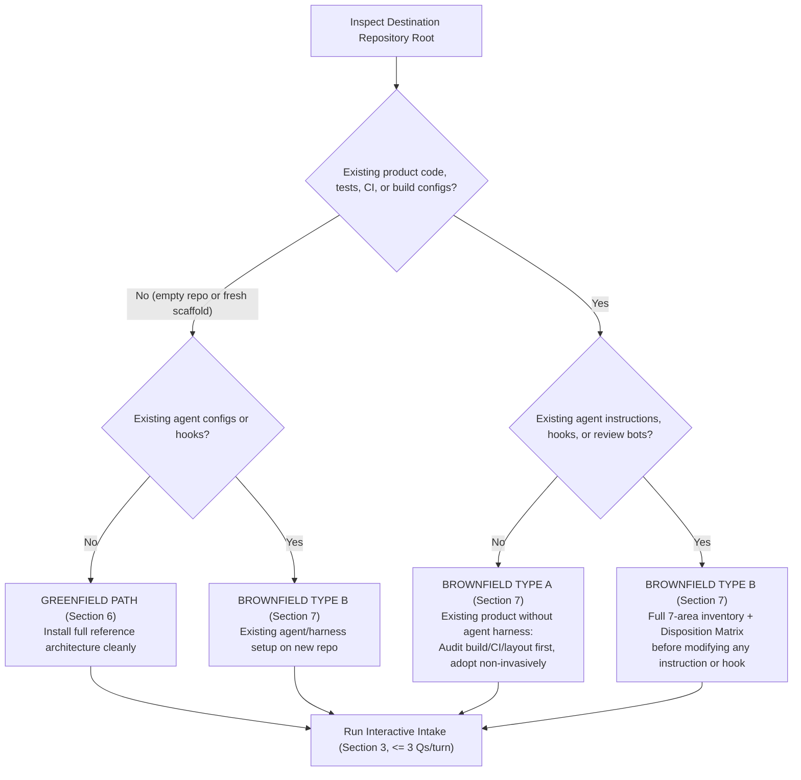
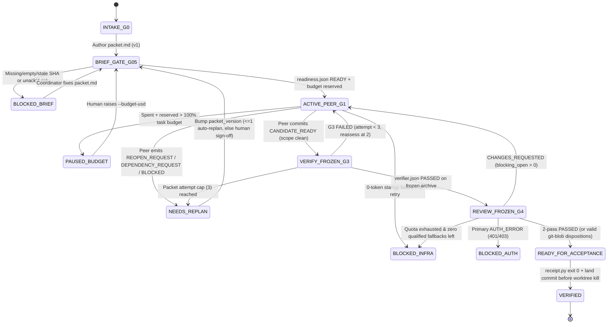

# Portable Multi-Agent Harness & Codex Room Setup Guide

> **Audience:** Target-Repository Setup Agent (primary executor) and Human Engineering Maintainer (decision owner).  
> **Source Reference Baseline:** `topstep-chart-app` (`htu-chart`), branch `main`, commit `2ca5784a636eef436f34106aba10bb56ed5f866e` (inspected `2026-11-24`).  
> **Scope:** Self-contained blueprint for establishing or adapting the **Coordinator + Isolated Peer + 2-Pass Independent Review (`Codex Room`)** workflow across **greenfield** and **brownfield** codebases and across **Claude Code, OpenAI Codex CLI, Google Antigravity App/CLI, Gemini CLI, or custom API runtimes**.

> [!IMPORTANT]
> **Non-Certification Notice:** Authoring or reading this guide does **not** certify that any destination repository has been configured or verified. Keep **source baseline facts**, **guide examples / proposed configurations**, and **executed destination verification results** strictly separated in every status report.

### Command & Configuration Label Convention

Every command block and configuration snippet in this guide carries one of three explicit labels:

- **`[Demonstrated Source Command]`** — Exact command executed and verified in the source repository (`topstep-chart-app` at `2ca5784a636eef436f34106aba10bb56ed5f866e`).
- **`[Example Target Command]`** — Concrete command pattern for a destination repository containing explicit `<PLACEHOLDER>` tokens; the setup agent **must** verify flags against the destination's installed CLI versions before execution.
- **`[Proposed Configuration]`** — Reusable configuration, schema, prompt, or task-packet template to be adapted for the destination repository. Every block identifies its **Consumer(s)** and **Verification Check**.

---

## 1. Purpose, Scope, and Verified Source Baseline

### 1.1 Purpose and Architectural Guarantee

Most multi-agent coding setups fail in one of two ways: either multiple agents edit a shared working tree with ambiguous ownership and rubber-stamp each other's output, or prose-heavy `AGENTS.md` files list dozens of rules with zero mechanical enforcement.

This guide extracts the **portable engineering harness** proven in `topstep-chart-app` so another agent can install or adapt the same guarantees in an unrelated codebase:

1. **One accountable Coordinator** owns task decomposition, detailed Task Packets, scope boundaries, equal-colleague escalation (`REOPEN_REQUEST` / `DEPENDENCY_REQUEST` / `BLOCKED`), commit landing, and final acceptance (`test pass != acceptance`).
2. **A mechanical Brief Readiness Gate (`G0.5`)** blocks Peer dispatch on missing, empty, schema-incomplete, stale-SHA, or unacknowledged high-risk Task Packets, emitting a write-once `readiness.json`.
3. **Scoped, isolated Peer execution (`G1`/`G2`)** runs inside a separate context and isolated Git worktree, writes behavioral tests (including observed pre-fix `RED` -> post-fix `GREEN` for bugfixes), and delivers an immutable commit SHA (`CANDIDATE_READY`).
4. **Durable root-task state and budget circuit breakers (`task_runner.py`)** persist attempt counts, replan counts, and deduplicated token spend across restarts, replans, and model switches under an OS-file-locked `ledger.json` keyed by `root_task_id`.
5. **Frozen candidate verification (`G3`)** exports `candidate_sha` via `git archive` into a clean temporary directory with module-path isolation so untracked worktree files cannot mask broken imports or dirty state.
6. **Independent 2-pass read-only review (`G4` Codex Room)** evaluates the exact frozen tree and `candidate.patch` in two separate zero-history contexts (`pass1`: correctness & test sensitivity; `pass2`: security & architectural invariants) validated against a strict JSON Schema, backed by typed failure classification and canary-qualified fallback routes.
7. **Write-once acceptance receipts (`G5`)** cross-verify `readiness.json`, `verifier.json`, `red_proof.json` (for bugfixes), `consolidated-review.json`, and git-blob-verified `dispositions.json` on the exact same `candidate_sha`.

### 1.2 Verified Source Baseline Snapshot

All source claims in this guide are anchored to the following inspected state:

| Attribute | Verified Source Fact |
| :--- | :--- |
| **Source Repository** | `https://github.com/LonguniBIM/htu-chart` (`topstep-chart-app` workspace) |
| **Inspected Branch & Commit** | `main` @ `2ca5784a636eef436f34106aba10bb56ed5f866e` (`git status --porcelain` clean) |
| **Inspection Date** | `2026-11-24` |
| **Source Host OS & Shell** | Windows (`win32`), PowerShell |
| **Verified Tooling Versions** | `Python 3.14.3`, `uv 0.10.12`, `git 2.52.0.windows.1`, `codex-cli 0.172.0`, `agy 1.5.16` (Antigravity CLI), `ruff 0.15.15`, `pytest 8.4.2` |
| **Source Validation Evidence** | `134` harness contract tests (`harness/tests/`) + `251` backend tests (`backend/tests/`) passing; `arch_check.py` `0` active violations; `verify_app.py doctor/launch/smoke/cleanup` `passed=true`; live 4-case `reviewer_canary.py` `4/4 PASS` on `gemini-4-carbon-high`; live 2-pass primary `codex` (`gpt-6.1-sol` `high`) review `PASSED` (`blocking_open=0`, `fallback=False`) + `VERIFIED` receipts through `R5B` |

### 1.3 Portable Contracts vs. Source-Specific Domain Rules

Do **not** copy source-specific trading rules, environment variable names, or directory assumptions into unrelated repositories.

| Layer | Portable Contract (Keep & Adapt) | Source-Specific Artifact (Strip or Replace in Destination) |
| :--- | :--- | :--- |
| **Role Topology** | 1 Coordinator + Isolated Worktree Peer + 2-Pass Zero-History Read-Only Reviewer | S-L-P small-codebase naming tied specifically to TopstepX futures modules |
| **Readiness (`G0.5`)** | 2-layer structural + git-blob + risk-flag readiness check writing `O_EXCL` `readiness.json` | Source `RISK_PATH_MARKERS` (`topstep/`, `routes/`, `app.py`, `config.py`, `harness/`) |
| **Pre-Tool Hooks** | Canonical `Path.resolve()` secret-file deny, policy-weakening deny, internal-executor write guard | TopstepX `/api/Order`, `/api/Position`, `/hubs/user` regexes; sibling `../lightweight-charts/` fork deny |
| **Static Architecture (`arch_check`)** | `MOD-001` model-policy consumer scan, `TEST-001` anti-tautology test scan, expiring `EXEMPT(RULE, owner=..., expires=YYYY-MM-DD, reason=...)` discipline | `SEC-001` Prop Firm read-only tokens, `SEC-002` `TOPSTEPX_API_KEY`/`TELEGRAM_BOT_TOKEN`, `SEC-003` Tailscale bind, `ARCH-001..004` FastAPI/Parquet/SQLite layers, `ARCH-005` CME Globex `18:00 America/New_York` reset, `ARCH-006` sibling fork check |
| **Frozen Verifier (`G3`)** | `git archive <commit>` extraction, `sys.path` / module isolation, `0 collected` test failure, bounded process-tree timeouts | Hardcoded `topstep-chart-app` archive folder basename (required by source `test_security_f01.py:702`) and Python `ruff`/`pytest` commands |
| **2-Pass Review (`G4`)** | `frozen/` sandbox containment, strict `review-output.schema.json`, no majority-vote dismissal, typed failure classifier, 7-tuple pass reuse, 4-case canary gate | TopstepX-specific Pass 2 prompt examples (`SEC-001` order endpoints, CME Globex session boundaries) |
| **Model Policy** | Machine-readable `harness/model-policy.json` enforced at every consumer + explicit user exclusions | Source-specific quota pool snapshot timestamps and Gemini-specific defaults when the target project uses Claude or Codex |

### 1.4 Four-Bucket Classification of Reference Components

Every component in `topstep-chart-app` at `2ca5784a636eef436f34106aba10bb56ed5f866e` falls into one of four verification buckets:

1. **Implemented and verified (`production_verified` in source):**
   - `harness/scripts/schema_utils.py` (451 lines)
   - `harness/scripts/brief_gate.py` (1,060 lines)
   - `harness/scripts/task_runner.py` (1,916 lines)
   - `harness/scripts/build_verifier.py` (695 lines — Phases `0..2` verified in production runs)
   - `harness/scripts/codex_room_sync.py` (629 lines) + `harness/codex-room/overlays/*.config.toml` + `harness/codex-room/schemas/review-output.schema.json` (117 lines)
   - `harness/scripts/codex_room_review.py` (2,290 lines — both primary `codex` `gpt-6.1-sol` `high` and canary-qualified `agy` `gemini-4-carbon-high` fallback verified live)
   - `harness/scripts/reviewer_canary.py` (550 lines — 4-case live qualification verified)
   - `harness/scripts/receipt.py` (756 lines)
   - `harness/model-policy.json` (91 lines) + `.agents/hooks.json` (16 lines) + `harness/scripts/safety_hook.py` (497 lines) + `MOD-001`/`TEST-001`/`SLOP-001` in `harness/scripts/arch_check.py` (866 lines)
   - `AGENTS.md` (52 lines), `docs/WORKSPACE_PROTOCOL.md` (242 lines), `docs/statecharts.md` §4, `.references/test-required.md` (128 lines), and `.agents/skills/{slp-orchestrator,codex-room-review,correct-loop}/**`
2. **Implemented in code/policy, but partially verified or scope-constrained:**
   - `gemini-4-hydrogen-low` low-risk Peer route: gated mechanically by `brief_gate.py` (eligible only when all 5 `risk_flags` are `false`), `0` live task trials executed yet (`constrained_candidate`).
   - `build_verifier.py` `phase >= 3` (`frontend_typecheck`, `frontend_build`): implemented in `build_verifier.py` and `receipt.py`, not yet exercised on live `frontend/` code because source Phase 3 has not started.
   - `claude-opus-5-5-medium` and `gemini-4-neon-high` fallback reviewer entries: listed in `unqualified_candidates_requiring_canary` in `harness/model-policy.json` and intentionally blocked from `--backend auto` until `reviewer_canary.py` passes (`4/4`).
   - Antigravity App `Orchestrator` UI mode (`Gemini 4 Neon Medium` planner + `Gemini 4 Hydrogen High` internal executor): documented and hook-guarded (`forbid_internal_executor_product_writes: true`), while App UI transcripts do not expose resolved `effort` (`observed_effort: "unknown"`).
3. **Proposed only (adapter patterns authored in this guide, not standalone scripts in source):**
   - Native Claude Code `.claude/settings.json` + `.claude/agents/peer.md` (`isolation: "worktree"`) adapter.
   - Native Gemini CLI `.gemini/settings.json` (`BeforeTool` hook + `general.defaultApprovalMode: "plan"`) adapter.
   - Portable Git-worktree CLI wrapper (`dispatch_peer_worktree.py` / `codex exec --worktree`) for runtimes without Antigravity's native `swarm(workspace="share")` tool.
4. **Specific to the source project's domain or environment (do not port as-is):**
   - `SEC-001..003` and `ARCH-001..006` rules in `harness/scripts/arch_check.py` and `harness/scripts/safety_hook.py`.
   - `harness/scripts/verify_app.py` (616 lines — probes TopstepX FastAPI `/api/health`, `/api/status`, and SignalR read-only invariants; port only its `doctor/launch/smoke/cleanup` lifecycle pattern).
   - `harness/evidence/benchmarks/reconciled_metrics_v2.json` and `harness/evidence/canary-carbon-high/canary-report.json` (source-project empirical evidence artifacts, not destination certifications).

### 1.5 Source Provenance Manifest and Precise Retrieval / Adaptation Instructions

Never copy the entire `harness/` directory blindly. Retrieve only portable files from pinned commit `2ca5784a636eef436f34106aba10bb56ed5f866e` and apply the exact adaptations in the rightmost column.

**`[Example Target Command]` — Selective Extraction from Source Repository:**

```bash
# Run from destination repository root after fetching or cloning the source repo at <SOURCE_REPO_DIR>
git -C "<SOURCE_REPO_DIR>" archive 2ca5784a636eef436f34106aba10bb56ed5f866e \
  harness/scripts/schema_utils.py \
  harness/scripts/brief_gate.py \
  harness/scripts/task_runner.py \
  harness/scripts/build_verifier.py \
  harness/scripts/codex_room_sync.py \
  harness/scripts/codex_room_review.py \
  harness/scripts/reviewer_canary.py \
  harness/scripts/receipt.py \
  harness/codex-room/schemas/review-output.schema.json \
  harness/codex-room/overlays/review-pass1-correctness.config.toml \
  harness/codex-room/overlays/review-pass2-security.config.toml \
  harness/codex-room/prompts/pass1-correctness.md \
  harness/codex-room/prompts/pass2-security.md \
  | tar -x -C "<DEST_REPO_DIR>"
```

| Component | Source Path @ `2ca5784a636e` | Purpose | Dependencies | Status Bucket | Required Destination Adaptation |
| :--- | :--- | :--- | :--- | :--- | :--- |
| **Schema & Process Primitives** | `harness/scripts/schema_utils.py` (451L) | Strict Draft 2020-12 subset validator (`bool`!=`int`, `additionalProperties`), `git archive` tree materializer (`0o444` read-only option), SHA-256 tree hashing, Win32 Job Object / POSIX `start_new_session` process-tree runner | Python `>=3.11` stdlib + `git` | Bucket 1 (`production_verified`) | Portable as-is. Keep `remove_readonly` `shutil.rmtree` handler for Windows compatibility. |
| **Brief Readiness Gate (`G0.5`)** | `harness/scripts/brief_gate.py` (1,060L) | Validates Task Packet sections, `base_sha` git commit existence, owned/denied path disjointness, bugfix regression plan, and Layer-2 high-risk path acknowledgment; writes `O_EXCL` `readiness.json` | `schema_utils.py`, `harness/model-policy.json` | Bucket 1 (`production_verified`) | Replace `RISK_PATH_MARKERS` (auth, migrations, billing, public API, `harness/`) and replace default Peer model IDs if primary runtime is Claude or Codex. |
| **Task State & Budget Runner** | `harness/scripts/task_runner.py` (1,916L) | OS-file-locked (`msvcrt`/`fcntl`) atomic `ledger.json` keyed by `root_task_id`; enforces attempt/replan/infra caps, `git diff --no-renames` scope check, cumulative vs delta token deduplication, and `80%/100%` USD budget gates | `schema_utils.py`, `brief_gate.py`, `harness/model-policy.json` | Bucket 1 (`production_verified`) | Update pricing table in `model-policy.json` and tune numeric thresholds (`max_attempts_per_packet`, `budget_usd`) in policy/CLI flags if task granularity differs. |
| **Frozen Build Verifier (`G3`)** | `harness/scripts/build_verifier.py` (695L) | Exports `--commit <sha>` to temp archive, isolates Python `sys.path` via `_site_guard/sitecustomize.py`, runs static/lint/test phases, fails on `0 collected` tests, emits `verifier.json` | `schema_utils.py`, target build/test tools | Bucket 1 (`phase 0..2`), Bucket 2 (`phase >=3`) | **Mandatory edits:** (1) Change extracted archive folder basename from `"topstep-chart-app"` to `<PROJECT_SLUG>`; (2) Replace `arch_check`/`ruff`/`pytest` phase table with destination lint, typecheck, test, and build commands; (3) Keep empty-test-suite detection (`0 collected` / `0 tests`). |
| **Codex Room Runtime Sync** | `harness/scripts/codex_room_sync.py` (629L) + `overlays/*.config.toml` | Syncs `~/.codex/auth.json` into isolated runtime homes (`<SLUG>-review-pass1`, `<SLUG>-review-pass2`) and locks `sandbox_mode="read-only"`, `approval_policy="never"`, `multi_agent=false` | `tomllib` (Python `>=3.11`), `harness/model-policy.json`, `codex` CLI (when used) | Bucket 1 (`production_verified`) | Rename runtime directory prefix from `topstep-review-pass{1,2}` to `<PROJECT_SLUG>-review-pass{1,2}` so multiple repositories do not overwrite each other's synced configs. |
| **2-Pass Reviewer (`G4`)** | `harness/scripts/codex_room_review.py` (2,290L) + `review-output.schema.json` (117L) | Materializes `frozen/` + `frozen/candidate.patch` + `frozen/prompts/`, runs Pass 1 & Pass 2 (`codex` primary or canary-qualified fallback), classifies failures, tracks quota pools, supports 7-tuple `--resume-from`, writes `consolidated-review.json` | `schema_utils.py`, `codex_room_sync.py`, `model-policy.json` | Bucket 1 (`production_verified`) | Rewrite Pass 2 prompt invariants (`_build_pass2_prompt`) to check `<DEST_SECURITY_AND_ARCH_INVARIANTS>` instead of TopstepX `SEC-001..003`/`ARCH-001..006`. Add a `"claude"` backend runner if Claude CLI (`claude -p --json-schema`) is used as fallback instead of `agy`. |
| **Fallback Qualification Canary** | `harness/scripts/reviewer_canary.py` (550L) | Runs 4 synthetic git-repo test cases (`clean_control`, `seeded_logic_bug`, `seeded_boundary_violation`, `malformed_contract_rejection`) to qualify fallback reviewer models | `codex_room_review.py`, `schema_utils.py` | Bucket 1 (`production_verified`) | Replace Case 3 (`seeded_boundary_violation`) synthetic payload with a violation matching `<DEST_SECURITY_INVARIANT>` so Pass 2 tests real destination detection sensitivity. |
| **Immutable Receipt Gate (`G5`)** | `harness/scripts/receipt.py` (756L) | Cross-checks `readiness.json`, `verifier.json`, `red_proof.json` (bugfix), `consolidated-review.json`, and git-blob `dispositions.json` on `candidate_sha`; writes `O_EXCL` `receipt.json` | `schema_utils.py`, `model-policy.json` | Bucket 1 (`production_verified`) | Update required `verifier.json` step names (`REQUIRED_STEPS_BY_PHASE`) to match the destination `build_verifier.py` step IDs. |
| **Pre-Tool Safety Hook** | `.agents/hooks.json` (16L) + `harness/scripts/safety_hook.py` (497L) | Intercepts file edits and shell commands before execution; enforces `.env` deny, policy immutability, canonical path resolution, and internal-executor write guards | Host hook runner (`.agents/hooks.json`, `.claude/settings.json`, or `.gemini/settings.json`) | Bucket 1 (AGY), Bucket 3 (Claude/Gemini adapters) | Strip TopstepX `/api/Order` and `lightweight-charts` checks; configure `<DEST_PROTECTED_PATHS>`, `<DEST_SECRET_PATTERNS>`, and host-specific JSON output format (Section 9.5). |
| **Static Policy & Test Linter** | `harness/scripts/arch_check.py` (866L) | Enforces `MOD-001` (denylisted models across code/configs/docs), `TEST-001` (tautological assertions / swallowed exceptions), and expiring `EXEMPT(...)` tags | Python `ast` stdlib, `harness/model-policy.json` | Bucket 1 (`MOD-001`, `TEST-001`), Bucket 4 (`SEC-*`/`ARCH-*`) | Retain `_scan_model_policy_compliance` (`MOD-001`), `TEST-001`, and `parse_exempt`; replace `SEC-001..003` and `ARCH-001..006` with destination module/security boundaries. |

---

## 2. Quick Decision Path for Greenfield vs. Brownfield

> [!WARNING]
> **Critical Classification Rule:** An existing product repository that has **no** `AGENTS.md`, `CLAUDE.md`, hooks, or multi-agent scripts is **still Brownfield** (`Brownfield Type A`). It already has directory conventions, build/test runners, developer workflows, or CI pipelines that must be audited and preserved rather than overwritten.



| Repository State | Classification | Required Procedure | First Implementation Move |
| :--- | :--- | :--- | :--- |
| Empty repo or brand-new project scaffold with zero product code and zero CI/agent rules | **Greenfield** | Complete Section 3 intake -> Section 4 model recommendation -> Section 6 Steps `1..9` in order | Create directory scaffold, `intake-record.json`, and `harness/model-policy.json` |
| Active codebase with tests/CI/linters, zero `AGENTS.md`/`CLAUDE.md`/hooks | **Brownfield Type A** | Complete Section 7.1 build/CI/layout inventory -> Section 3 intake -> Section 7.2 Disposition Matrix -> Wave 1 non-invasive `G3`+`G4` adoption | Wrap existing build/test commands in read-only `build_verifier.py --commit` without altering developer scripts |
| Active codebase with existing `AGENTS.md`, `CLAUDE.md`, `.claude/`, `.codex/`, `.agents/`, `.gemini/`, or PR review bots | **Brownfield Type B** | Complete all 7 inventory areas in Section 7.1 -> Section 3 intake -> Section 7.2 6-column Matrix -> backup existing configs -> staged Waves `0..3` | Snapshot recovery tag/backups and map existing controls to Keep / Adapt / Replace / Retire |

---

## 3. Exact Interactive Intake Questions and Completed-Intake Template

### 3.1 Mandatory Executor Rules Before Asking Anything

When an agent is asked to apply this guide to a destination repository, it **must** execute these five rules in order:

1. **Discover repository facts silently first:** Inspect `git status`, current branch/HEAD, OS platform, language manifests (`pyproject.toml`, `package.json`, `Cargo.toml`, `go.mod`, etc.), CI workflows (`.github/workflows/`, `.gitlab-ci.yml`), existing agent files (`AGENTS.md`, `CLAUDE.md`, `GEMINI.md`, `.agents/`, `.claude/`, `.codex/`, `.gemini/`, `.cursor/`), and installed CLI `--version` outputs.
2. **Never re-ask known facts:** Pre-fill every answer already supplied by the user prompt or proved by repository inspection, and present discovered facts briefly for confirmation.
3. **Zero secrets in intake:** Never ask the user to paste API keys, OAuth tokens, `.env` files, or credentials. Ask only *which providers/CLIs are available and authenticated* (`configured` vs `not configured`).
4. **Hard cap of `<= 3` questions per turn:** Group missing decisions into turns of **at most three focused questions**. Wait for the user's reply before asking Turn 2 questions (if any remain).
5. **Mandatory First Unanswered Question (`Q1`):** Whenever the user has not already named their primary agent and runtime, **Question 1 of Turn 1 must establish the primary agent and actual execution runtime**, including recognizable examples and an explicit clarification that *"primary/frontier agent" means your main day-to-day development agent — it does not automatically require picking the most expensive model tier*.

### 3.2 Exact Reusable Intake Prompts

#### Turn 1 (Ask up to 3 unanswered questions; `Q1` MUST come first)

```markdown
Before configuring the workflow, I inspected `<REPO_NAME>` (`<GREENFIELD_OR_BROWNFIELD>`, detected stack: `<DETECTED_STACK>`, detected build/test commands: `<DETECTED_COMMANDS>`, existing agent files: `<EXISTING_AGENT_FILES_OR_NONE>`). To tailor the harness without guessing, please answer up to three questions:

1. **Primary development agent and runtime:** Which main agent and client runtime will drive day-to-day Coordinator and coding work in this repository?
   - Examples: **Claude Code** (CLI or IDE extension), **OpenAI Codex** (CLI or App), **Google Antigravity** (App or `agy` CLI), **Gemini CLI** (`gemini`), a **custom API/SDK runner**, or **Unsure / Other** (tell me what subscriptions/tools you have installed).
   - *(Note: "primary/frontier agent" here means your main development environment, not an automatic requirement to use the highest-cost model tier.)*

2. **Independent review & provider availability (no secrets needed):** Which CLI tools or provider accounts are currently signed in and permitted for **independent read-only code review** and **fallback**?
   - For example: Is `codex` CLI authenticated for 2-pass Codex Room review, and which secondary runtimes/providers (Claude, Gemini/`agy`, OpenAI API, or none) are permitted if primary review quota is exhausted? Please also note any **hard model or provider exclusions**.

3. **Project posture & protected boundaries:** Please confirm `<GREENFIELD_OR_BROWNFIELD>` mode and name any **high-risk or off-limits paths/operations** (for example: production credentials, payment/order endpoints, database migrations, sibling repos, or network/privacy restrictions) that agents must never modify or invoke without explicit human sign-off.
```

#### Turn 2 (Ask ONLY if still unanswered after Turn 1; maximum 3 questions)

```markdown
Thank you. Two/three final calibration questions before I generate your model recommendation table and migration/setup plan:

1. **Cost, latency, and quality priority:** Should role model selection optimize for a **balanced practical default** (recommended), **lower token/quota cost**, **maximum reasoning rigor on complex architecture**, or **faster turnaround latency**? (You may also specify a per-task USD budget cap if desired.)

2. **Specific model or effort preferences:** Have you already chosen preferred models, reasoning/effort levels, or retry limits for Coordinator, Peer, or Reviewer—or are you **unsure** and want one concrete recommended default (plus tradeoffs where relevant)?

3. **Authoritative verification commands:** Should frozen candidate verification (`G3`) run `<DETECTED_LINT_TYPECHECK_TEST_COMMANDS>` as the mandatory gate, or should any command be added, replaced, or scoped by phase?
```

### 3.3 Completed-Intake Record Template (`harness/intake-record.json`)

- **Label:** `[Proposed Configuration]`
- **Consumer(s):** Setup Agent (Sections 4–7), `harness/model-policy.json` generator, `brief_gate.py` (`RISK_PATH_MARKERS`), and `build_verifier.py` command table.
- **Verification Check:** Validate JSON syntax (`python -m json.tool harness/intake-record.json > /dev/null`) and verify zero secret literals exist (`arch_check.py` secret scan).

```json
{
  "schema_version": 1,
  "recorded_at_utc": "<YYYY-MM-DDTHH:MM:SSZ>",
  "project_slug": "<PROJECT_SLUG>",
  "posture": "<greenfield | brownfield_type_a | brownfield_type_b>",
  "discovered_facts": {
    "git_branch": "<BRANCH_NAME>",
    "baseline_head_sha": "<40_CHAR_GIT_SHA_OR_UNBORN>",
    "working_tree_clean": true,
    "host_os": "<windows | linux | macos>",
    "languages_and_frameworks": ["<LANGUAGE_1>", "<FRAMEWORK_1>"],
    "existing_ci_files": ["<CI_PATH_OR_EMPTY>"],
    "existing_agent_files": ["<AGENT_DOC_OR_HOOK_PATH_OR_EMPTY>"],
    "installed_clis": {
      "claude": "<VERSION_OR_NOT_INSTALLED>",
      "codex": "<VERSION_OR_NOT_INSTALLED>",
      "agy": "<VERSION_OR_NOT_INSTALLED>",
      "gemini": "<VERSION_OR_NOT_INSTALLED>"
    }
  },
  "user_choices": {
    "primary_agent_family": "<claude_code | openai_codex | google_antigravity | gemini_cli | custom_api>",
    "execution_surface": "<cli | ide_app | hybrid_app_and_cli | headless_ci>",
    "optimization_priority": "<balanced_default | cost_conserving | quality_focused | low_latency>",
    "explicit_model_preferences": {
      "coordinator": "<MODEL_ID_OR_UNSPECIFIED>",
      "peer": "<MODEL_ID_OR_UNSPECIFIED>",
      "reviewer_pass1": "<MODEL_ID_OR_UNSPECIFIED>",
      "reviewer_pass2": "<MODEL_ID_OR_UNSPECIFIED>"
    },
    "explicit_effort_preferences": {
      "coordinator": "<EFFORT_OR_UNSPECIFIED>",
      "peer": "<EFFORT_OR_UNSPECIFIED>",
      "reviewer": "<EFFORT_OR_UNSPECIFIED>"
    },
    "excluded_model_prefixes": [
      "<EXCLUDED_PREFIX_1>"
    ],
    "task_budget_usd_default": 6.0,
    "privacy_or_network_constraints": ["<CONSTRAINT_OR_NONE>"]
  },
  "provider_readiness_no_secrets": {
    "primary_runtime_authenticated": true,
    "codex_room_authenticated": "<true | false>",
    "permitted_fallback_runtimes": ["<agy | claude | codex | none>"]
  },
  "protected_boundaries": {
    "denied_paths": [".env", ".env.*", "<DEST_DENIED_PATH>"],
    "high_risk_path_markers": ["<AUTH_DIR>/", "<MIGRATIONS_DIR>/", "harness/"],
    "forbidden_operations": ["<DEST_FORBIDDEN_OPERATION_OR_NONE>"]
  },
  "authoritative_g3_commands": {
    "static_and_policy": ["python harness/scripts/arch_check.py --root ."],
    "lint": ["<LINT_COMMAND>"],
    "typecheck": ["<TYPECHECK_COMMAND>"],
    "unit_and_integration_tests": ["<TEST_COMMAND>"]
  },
  "unresolved_items": []
}
```

---

## 4. Runtime Capability Assessment and Model/Effort Recommendation Workflow

### 4.1 Live Runtime Inspection Protocol (Before Recommending Models)

Model catalogs, CLI flags, and effort controls change over time. After `Q1` establishes the primary runtime, the setup agent **must** inspect the locally installed CLI and check current official vendor documentation rather than relying on stale memory.

**`[Demonstrated Source Command]` — Verified Inspection Probes on Source Host (`2026-11-24`):**

```powershell
# Antigravity CLI (verified on agy 1.5.16)
agy --version
agy models

# OpenAI Codex CLI (verified on codex-cli 0.172.0)
codex --version
codex exec --help
```

**`[Example Target Command]` — Inspection Probes for Claude Code or Gemini CLI Destinations:**

```bash
# Claude Code CLI (verify installed version, flags, and configured settings precedence)
claude --version
claude --help

# Gemini CLI (verify installed version, approval modes, sandbox, and hook support)
gemini --version
gemini --help
```

Check these five runtime properties before writing `harness/model-policy.json`:

1. **Callable model IDs** accepted by CLI/config (do **not** assume a GUI dropdown label such as `"Gemini 4 Neon Medium"` is the CLI model ID; on `agy 1.5.16`, the CLI slug is `gemini-4-neon-medium`).
2. **Effort / reasoning control mechanism** (separate config key/flag, baked into model slug, automatic, or unsupported).
3. **Subagent / isolated Git worktree primitive** (`swarm(workspace="share")`, `.claude/agents/*.md` with `isolation: "worktree"`, `codex exec --worktree`, or external `git worktree add` script).
4. **Deterministic tool-interception hook** (`.agents/hooks.json` `PreToolUse`, `.claude/settings.json` `PreToolUse`, `.gemini/settings.json` `BeforeTool`, or OS/CLI sandbox where client hooks are absent).
5. **Configuration precedence** (CLI flags -> project config -> profile -> global user config) so user global defaults cannot silently override read-only reviewer locks or project exclusions.

### 4.2 Decision Process for Model and Effort Selection

Apply one of three explicit decision branches:

1. **User specifies desired models and efforts:**
   - Verify each requested model ID and effort setting exists in the target runtime and complies with user exclusions and reviewer schema/sandbox requirements.
   - Honor supported choices directly. If a choice has a concrete incompatibility (for example: a model cannot emit `--output-schema` JSON, or a CLI lacks a separate `--effort` parameter), explain the exact technical incompatibility and propose the closest supported option without silently substituting it.
2. **User is unsure:**
   - Recommend **one practical default configuration** tailored to the user's chosen primary agent family (see Profiles A, B, and C in Section 4.4) with clear role-based rationale:
     - **Coordinator:** Strong decomposition, spec-auditing, and ambiguity detection at moderate/balanced effort (`medium` or equivalent) to avoid burning max-reasoning tokens on routine orchestration turns.
     - **Peer:** High coding + tool-use reliability (`high` effort on coding-optimized workhorse model) inside an isolated worktree; optionally define a constrained low-cost tier gated mechanically by `brief_gate.py` (`all risk_flags == false`).
     - **Independent Reviewer (Pass 1 & Pass 2):** High reasoning effort (`high`) in two isolated zero-history read-only contexts so subtle concurrency, state-machine, and boundary bugs are caught before acceptance.
   - Offer a **cheaper** or **quality-focused** alternative **only** when there is a meaningful tradeoff (for example, escalating Coordinator to `high`/Opus on cross-cutting architecture replans, or gating low-risk Peer tasks). Do **not** demand a paid benchmark run merely to complete setup.
3. **Runtime lacks a separate effort control:**
   - Record the effort column honestly as **`fixed (encoded in model slug)`**, **`automatic (provider-managed)`**, or **`unsupported`**.
   - **Never invent non-existent flags or config keys**, and **never assume `"medium"` or `"high"` represents the same reasoning token budget across Anthropic, OpenAI, and Google**.

### 4.3 Explicit Model Exclusion Policy Carry-Forward

Always enforce explicit user exclusions in `harness/model-policy.json` (`excluded_model_prefixes`) and static check `MOD-001`.

- **Carry-Forward Rule for Gemini / Antigravity Configurations:** Unless the project owner explicitly revises this policy during intake, any destination using Gemini or Antigravity routes **must exclude Gemini 3.8 Flash and Gemini 4 Argon immediately** (scheduled for product withdrawal on `2026-11-30`), along with silent API alias redirects:
  - Excluded prefixes in `model-policy.json`: `"gemini-3.8-flash"`, `"gemini-4-argon"`, `"gemini-pro-orchestrator-argon"`, `"gemini-3.7-flash"`, `"gemini-2.5-pro"`.
- **Provider Neutrality Rule:** Do **not** copy Gemini model defaults into a Claude-primary or Codex-primary project, and do not copy Gemini-only exclusion prefixes into a pure Claude/OpenAI policy unless Gemini fallback routes are enabled.

### 4.4 Role Recommendation Tables by Primary Agent Family

Use the table matching the destination's `primary_agent_family` from `intake-record.json` as the baseline `[Proposed Configuration]`, adapting `<PLACEHOLDER>` paths and user preferences.

#### Profile A — Google Antigravity / Gemini Primary + Codex Room Review (Source-Proven Reference)

| Role | Runtime/route | Model | Effort or supported equivalent | Configuration location and key | Rationale | Escalation/fallback | Verification status |
| :--- | :--- | :--- | :--- | :--- | :--- | :--- | :--- |
| Coordinator | Antigravity CLI (`agy`) or App session | `gemini-4-neon-medium` (CLI) / `Gemini 4 Neon Medium` (App) | `fixed` in CLI slug (`-medium`); App UI effort `unexposed` (`observed: unknown`) | `harness/model-policy.json` -> `roles.coordinator.cli_default_model` | Empirical source benchmark (`reconciled_metrics_v2.json`): `3/3` pass rate at `$1.54` mean task cost vs `$2.12` on heavier orchestrator comparator | Escalate to `gemini-4-carbon-high` or `gemini-4-neon-high` on `>=2` failed replans or cross-layer architecture redesign | `production_verified` (CLI & benchmarked in source); App `observed_effort` `unknown` |
| Peer | Antigravity native `swarm(action="add", workspace="share")` | `gemini-4-hydrogen-high` | `fixed` in CLI/swarm slug (`-high`) | `harness/model-policy.json` -> `roles.peer.default_model`; validated by `task_runner.py check-dispatch` | Reliable multi-file coding + value-first test authoring inside isolated `share` git worktree | Optional `gemini-4-hydrogen-low` **only** when `brief_gate.py` certifies `all 5 risk_flags == false`; escalate to `gemini-4-neon-high` after `2` failed implementation attempts | `gemini-4-hydrogen-high`: `production_verified`; `gemini-4-hydrogen-low`: `constrained_candidate` (`0` live trials) |
| Independent Reviewer — pass 1 | `codex_room_review.py` -> `codex exec` (`<SLUG>-review-pass1` home) | `gpt-6.1-sol` | `model_reasoning_effort = "high"` | `harness/codex-room/overlays/review-pass1-correctness.config.toml` + `model-policy.json` -> `roles.reviewer.primary` | Dedicated zero-history read-only pass focused on logic, concurrency, state transitions, and test sensitivity (`TEST-001`) | On `CONFIRMED_QUOTA_EXHAUSTED` only: `agy --sandbox --mode plan` with canary-qualified `gemini-4-carbon-high` (7-tuple pass reuse enabled) | Primary `gpt-6.1-sol` `high` & fallback `gemini-4-carbon-high`: `production_verified` (`4/4` canary `PASS`) |
| Independent Reviewer — pass 2 | `codex_room_review.py` -> `codex exec` (`<SLUG>-review-pass2` home) | `gpt-6.1-sol` | `model_reasoning_effort = "high"` | `harness/codex-room/overlays/review-pass2-security.config.toml` + `model-policy.json` -> `roles.independent_reviewer_primary` | Separate zero-history read-only pass focused on security, secrets, permissions, and architectural boundaries | Same typed quota-only fallback (`gemini-4-carbon-high`); code findings (`CHANGES_REQUESTED`) **never** trigger fallback | Primary `gpt-6.1-sol` `high` & fallback `gemini-4-carbon-high`: `production_verified` (`4/4` canary `PASS`) |

#### Profile B — Claude Code Primary + Codex Room Review (or Qualified Fallback)

| Role | Runtime/route | Model | Effort or supported equivalent | Configuration location and key | Rationale | Escalation/fallback | Verification status |
| :--- | :--- | :--- | :--- | :--- | :--- | :--- | :--- |
| Coordinator | Claude Code CLI / IDE (`claude`) | `claude-sonnet-5-5` *(quality alternative: `claude-opus-5-5`)* | `effortLevel: "medium"` (or `--effort medium`) | `.claude/settings.json` -> `model`, `effortLevel` + `harness/model-policy.json` -> `roles.coordinator` | Strong repository planning, Task Packet authoring, and escalation adjudication without incurring `max`/Opus cost on every turn | Escalate Coordinator session to `claude-opus-5-5` with `--effort high` for ambiguous brownfield architecture or `REOPEN_REQUEST` deadlock | `configured` pattern (CLI flags/settings verified in official Claude Code docs `2026-11-24`; run destination smoke check to mark `tested`) |
| Peer | Claude Code subagent with isolated Git worktree (`.claude/agents/peer.md`) | `claude-sonnet-5-5` | `effort: "high"` in subagent frontmatter | `.claude/agents/peer.md` (`isolation: "worktree"`, `model`, `effort`) + `task_runner.py check-dispatch` | Executes scoped Task Packet in `.claude/worktrees/` with dedicated context and strong code/test synthesis | Escalate to `claude-opus-5-5` (`effort: "high"`) on complex concurrency/state bugs after reassess threshold (`2` attempts) | `configured` pattern (official Claude Code docs `2026-11-24`; verify worktree commit retention in Step 5) |
| Independent Reviewer — pass 1 | `codex_room_review.py` -> `codex exec` (`<SLUG>-review-pass1`) | `gpt-6.1-sol` | `model_reasoning_effort = "high"` | `harness/codex-room/overlays/review-pass1-correctness.config.toml` | Independent zero-history read-only correctness & test-sensitivity lens on `frozen/` archive | If OpenAI/Codex is unavailable or quota-exhausted: run `reviewer_canary.py` (`4/4`) to qualify `claude -p --permission-mode plan --output-format json --json-schema` (`claude-opus-5-5` `high`) or `agy` `gemini-4-carbon-high` before enabling fallback | Primary `codex`: `production_verified` in source; Claude CLI fallback adapter: `unqualified_until_canary_passes` |
| Independent Reviewer — pass 2 | `codex_room_review.py` -> `codex exec` (`<SLUG>-review-pass2`) | `gpt-6.1-sol` | `model_reasoning_effort = "high"` | `harness/codex-room/overlays/review-pass2-security.config.toml` | Independent zero-history read-only security & boundary lens on `frozen/` archive | Same canary-gated fallback rule; if neither `codex` nor a canary-qualified read-only schema reviewer is available, mark `G4` `DEGRADED`/`BLOCKED` | Primary `codex`: `production_verified` in source; Claude CLI fallback adapter: `unqualified_until_canary_passes` |

#### Profile C — OpenAI Codex CLI Primary + Codex Room Review (Single-Provider, Multi-Context Independence)

| Role | Runtime/route | Model | Effort or supported equivalent | Configuration location and key | Rationale | Escalation/fallback | Verification status |
| :--- | :--- | :--- | :--- | :--- | :--- | :--- | :--- |
| Coordinator | OpenAI Codex CLI interactive session (`codex`) | `gpt-6.1-sol` | `model_reasoning_effort = "medium"` | `.codex/config.toml` -> `model`, `model_reasoning_effort` + `harness/model-policy.json` | Native `AGENTS.md` ingestion and disciplined planning/adjudication at moderate reasoning budget | Escalate `-c model_reasoning_effort="high"` when adjudicating architectural `REOPEN_REQUEST` or complex multi-module packets | `configured` pattern (`codex-cli 0.172.0` flags verified locally `2026-11-24`) |
| Peer | Non-interactive worktree worker (`codex exec --worktree`) | `gpt-6.1-sol` | `-c model_reasoning_effort="high"` | Peer launcher wrapper invoking `codex exec --worktree -s workspace-write` + `task_runner.py` | Runs in a fresh managed Git worktree with zero Coordinator chat history and `workspace-write` sandbox | Lower `-c model_reasoning_effort="medium"` only for zero-risk `brief_gate`-certified packets if latency/quota is tight | `configured` pattern (`--worktree` and `-s workspace-write` verified in `codex-cli 0.172.0 --help`) |
| Independent Reviewer — pass 1 | `codex_room_review.py` -> `codex exec --ephemeral --ignore-user-config` (`CODEX_HOME=<SLUG>-pass1`) | `gpt-6.1-sol` | `model_reasoning_effort = "high"` | `overlays/review-pass1-correctness.config.toml` (`sandbox_mode="read-only"`, `approval_policy="never"`) | Independence comes from ephemeral zero-history execution over read-only `frozen/` + `candidate.patch`, even when Coordinator/Peer also use `gpt-6.1-sol` | Note: Shares `openai_codex` quota pool with Coordinator/Peer! Configure a cross-pool canary-qualified fallback (`claude` or `agy`) if quota continuity is required; otherwise fail closed (`BLOCKED_INFRA`) on pool exhaustion | `production_verified` in source (`codex-cli 0.172.0`) |
| Independent Reviewer — pass 2 | `codex_room_review.py` -> `codex exec --ephemeral --ignore-user-config` (`CODEX_HOME=<SLUG>-pass2`) | `gpt-6.1-sol` | `model_reasoning_effort = "high"` | `overlays/review-pass2-security.config.toml` (`sandbox_mode="read-only"`, `approval_policy="never"`) | Second isolated zero-history read-only pass for security, permissions, and boundary invariants | Same cross-pool fallback or fail-closed `BLOCKED_INFRA` rule | `production_verified` in source (`codex-cli 0.172.0`) |

> [!NOTE]
> **Gemini CLI (`gemini`) Note:** If the user selects standalone open-source **Gemini CLI** as primary runtime, configure Coordinator in `.gemini/settings.json` (`GEMINI.md` instructions + `hooks.BeforeTool`), dispatch Peer via a dedicated `git worktree add` subprocess running `gemini -p` in the isolated worktree (fixing any model exclusions in `model-policy.json`), and record effort as **`automatic / UI-display-only`** unless the installed `gemini --version` exposes an explicit `thinkingBudget`/`thinkingLevel` key in `settings.schema.json`.

### 4.5 Separate Internal Planner/Executor Pairing (Do Not Confuse with Isolated Peer)

Some IDE/CLI environments split a single session internally into a **Planner** model and an **Internal Executor** model. Document this pairing separately from the harness's Peer role:

| Host Runtime Feature | Internal Planner | Internal Executor | Workspace & Context Boundary | Mandatory Harness Rule |
| :--- | :--- | :--- | :--- | :--- |
| **Antigravity App `Orchestrator` Mode** | `Gemini 4 Neon Medium` (plans, reviews within Coordinator turn) | `Gemini 4 Hydrogen High` (runs Coordinator searches, read-only probes, harness CLI gates) | **Shared** Coordinator working tree and **shared** Coordinator conversation state | **Not an isolated Peer.** Set `forbid_internal_executor_product_writes: true` in `model-policy.json`; Coordinator/Internal Executor may edit `docs/`, `task.md`, and `harness/runs/<id>/packet.md`, never Peer-owned product source files. |
| **Gemini CLI `general.plan.modelRouting`** | Pro-tier model during `plan` mode | Flash/standard model after `exit_plan_mode` | **Shared** working tree and **shared** session history | **Not an isolated Peer.** Keep Coordinator in `plan` / orchestration scope; spawn Peer in a separate `git worktree` process (and ensure routed execution models respect `excluded_model_prefixes`). |

### 4.6 Configured vs. Resolved vs. Observed Runtime Telemetry

Every run record (`readiness.json`, `ledger.json`, `consolidated-review.json`, completion reports) must distinguish three layers rather than assuming a config file proves what ran:

| Telemetry Field | Meaning | Example (`Verified`) | Honest Fallback When Unexposed |
| :--- | :--- | :--- | :--- |
| **`configured`** | Value written in `model-policy.json`, `.claude/settings.json`, or `config.toml` | `model: "gemini-4-neon-medium"`, `effort: "medium"` | N/A (always known from file) |
| **`resolved`** | Value selected after applying CLI overrides, profile merges, and fallback routing | `codex_room_sync.py` merged `gpt-6.1-sol` + `high` | Record `"unresolved"` if dry-run aborted before sync |
| **`observed`** | Runtime model/effort/token metadata actually emitted in CLI JSONL events or API response headers | `codex exec --json` event stream (`gpt-6.1-sol`); `agy` `stream-json` `conversation_id` usage | Record `"unknown"` (e.g., Antigravity App UI does not emit resolved effort in transcript logs) |

---

## 5. Role Contracts, Gate Statechart, and Configuration Ownership

### 5.1 Portable Role Contracts and Configuration Ownership

| Role / Gate | Single Accountable Owner | Owns & Writes | Explicitly Forbidden From | Authoritative Config & Schema |
| :--- | :--- | :--- | :--- | :--- |
| **Coordinator (`G0`, Landing, Acceptance)** | Primary Agent Session | Scope triage, `packet.md` (`packet_version`), running `brief_gate.py`, adjudicating `REOPEN_REQUEST`, running `G3`/`G4`/`G5`, landing verified `candidate_sha`, updating feature/statechart docs | Editing Peer-owned product/test files directly; pressuring Peer to ignore spec conflicts; marking `VERIFIED` without `G3`+`G4`+`G5` exit `0` | Standing instructions (`AGENTS.md` / `CLAUDE.md` / `GEMINI.md`) + `harness/model-policy.json` |
| **Brief Readiness Gate (`G0.5`)** | `brief_gate.py` + `task_runner.py check-dispatch` | Write-once `readiness.json` (`O_EXCL`), `eligible_peer_models` calculation | Modifying `packet.md` or launching Peer when status != `READY` | `harness/scripts/brief_gate.py` + `harness/model-policy.json` |
| **Isolated Peer (`G1` / `G2`)** | Isolated Git Worktree Worker | Scoped code + behavioral tests inside `owned_paths`, pre-fix `RED` proof (bugfixes), immutable git commit (`CANDIDATE_READY`), or `REOPEN_REQUEST` / `DEPENDENCY_REQUEST` / `BLOCKED` | Touching `denied_paths` or files outside `owned_paths`; editing `harness/model-policy.json` or `.env*`; force-pushing or merging into `main` | Task Packet (`packet.md`), Peer agent definition, `PreToolUse` hook, `git diff --no-renames` check |
| **Frozen Build Verifier (`G3`)** | `build_verifier.py --commit <sha>` | Ephemeral archive verification + `verifier.json` | Running against dirty/uncommitted working tree for final acceptance; passing when `0` tests are collected | `harness/scripts/build_verifier.py` |
| **Independent Reviewer Pass 1 & Pass 2 (`G4`)** | `codex_room_review.py` (`pass1` + `pass2`) | `pass1-correctness.json`, `pass2-security.json`, `consolidated-review.json` | Editing repository files; reading Coordinator/Peer chat transcripts; spawning subagents; dismissing Pass 1 findings because Pass 2 was clean | `overlays/*.config.toml`, `review-output.schema.json`, `model-policy.json` |
| **Immutable Receipt Gate (`G5`)** | `receipt.py` | Write-once `receipt.json` (`VERIFIED`) | Overwriting existing receipt; accepting stale `candidate_sha` evidence or unverified `REFUTED_WITH_EVIDENCE` claims | `harness/scripts/receipt.py` |

### 5.2 Portable Task & Gate Statechart



### 5.3 Cross-Runtime Capability Matrix

Never assume identical runtime features across agent CLIs. Use this matrix (`Verified`, `Unsupported`, `Unverified`) to choose native mechanisms vs harness wrapper scripts:

| Capability | Google Antigravity (`agy 1.5.16` + App) | OpenAI Codex CLI (`codex-cli 0.172.0`) | Claude Code CLI / IDE | Gemini CLI (`gemini`) | Custom API / SDK Runner |
| :--- | :--- | :--- | :--- | :--- | :--- |
| **Standing Instruction Discovery** | **`Verified` (local):** `AGENTS.md` / `GEMINI.md` + `.agents/skills/*/SKILL.md` | **`Verified` (local & docs):** Hierarchical `~/.codex/AGENTS.md` -> repo `AGENTS.md` (`32 KiB` default cap) | **`Verified` (vendor docs):** `CLAUDE.md` hierarchy + `.claude/rules/` | **`Verified` (vendor docs):** `GEMINI.md` hierarchy | **`Unsupported` natively:** Runner must inject prompt files explicitly |
| **Native Isolated Worktree Peer Dispatch** | **`Verified` (local):** `swarm(action="add", workspace="share", model=...)` | **`Verified` (local `--help`):** `codex exec --worktree -s workspace-write` | **`Verified` (vendor docs):** `.claude/agents/<name>.md` with `isolation: "worktree"` | **`Unverified` natively:** Use harness `git worktree add` wrapper launching `gemini -p` | **`Unsupported` natively:** Use harness `git worktree add` wrapper |
| **Deterministic Pre-Tool Hook (`PreToolUse` / `BeforeTool`)** | **`Verified` (local):** `.agents/hooks.json` `PreToolUse` (`stdin` JSON -> `{"decision":"allow"\|"ask"\|"deny"}`, note `cwd=.agents/`) | **`Unverified` for local stdio tool-block:** Local CLI relies primarily on `sandbox_mode` + `approval_policy` + `.rules` (managed MCP hooks exist in cloud) | **`Verified` (vendor docs):** `.claude/settings.json` `hooks.PreToolUse` (`exit 2` or `hookSpecificOutput.permissionDecision: "deny"`) | **`Verified` (vendor docs):** `.gemini/settings.json` `hooks.BeforeTool` (`stdin` JSON, `exit 2` blocks) | **`Verified` by construction:** Enforce directly inside tool-executor middleware |
| **Read-Only OS / Filesystem Sandbox** | **`Verified` (local):** `agy --sandbox --mode plan` (restricts `read_file` to `cwd` subtree) | **`Verified` (local):** `-s read-only` / `sandbox_mode = "read-only"` + `approval_policy = "never"` | **`Verified` (vendor docs):** `--permission-mode plan` + `disallowedTools: ["Edit","Write","Bash"]` | **`Verified` (vendor docs):** `general.defaultApprovalMode: "plan"` + `"sandbox": true` (Docker/Podman/OS) | **`Unsupported` natively:** Must run inside container or read-only `0o444` mount |
| **Non-Interactive JSON Schema Output** | **`Verified` (local):** `agy --output-format stream-json --json-schema <file> -p` | **`Verified` (local):** `codex exec --output-schema <file> -o <out.json> --json --ephemeral` | **`Verified` (vendor docs):** `claude -p --output-format json --json-schema <schema>` | **`Unverified` (`--json-schema` flag):** Supports `--output-format json\|stream-json`; validate strict schema externally via `schema_utils.py` | **`Verified`:** Provider structured-outputs API + `schema_utils.py` |
| **Separate Effort / Reasoning Knob** | **`Verified` (local):** `fixed` per CLI model slug (`-low`/`-medium`/`-high`/`-xhigh`); App UI `observed` effort **`Unsupported`** (`unknown`) | **`Verified` (local):** `model_reasoning_effort = "low"\|"medium"\|"high"` in `config.toml` or `-c` | **`Verified` (vendor docs):** `effortLevel` (`"low"`..`"max"`) in `settings.json` or `--effort` | **`Unverified` for CLI per-call flag:** `ui.thinking` controls display; record effort as `automatic` unless schema exposes `thinkingConfig` | **`Verified`:** Provider API `reasoning.effort` / `thinking_config` where model supports it |
| **Usage Token Counter Semantics** | **`Verified` (local):** `agy` `stream-json` emits **cumulative** totals per `conversation_id` (`--counter-mode cumulative` required!) | **`Verified` (local):** `codex exec --json` emits per-invocation turn usage (`--counter-mode delta`) | **`Unverified` locally:** Inspect `--output-format json` `usage` payload on first smoke run before choosing `delta` vs `cumulative` | **`Unverified` locally:** Inspect `--output-format json` stats block on first smoke run | **`Verified`:** Per-response API usage (`--counter-mode delta`) |

---

## 6. Numbered Greenfield Setup Procedure

Execute Steps `1` through `9` in order after completing the Section 3 intake (`harness/intake-record.json`) and Section 4 role recommendation table. Do **not** skip ahead when a completion check fails.

### Step 1 — Scaffold Harness Layout and Git Ignore Boundaries

1. Create the directory structure:
   - `harness/scripts/` (deterministic gates & runners)
   - `harness/codex-room/overlays/` and `harness/codex-room/schemas/` (read-only reviewer configs & JSON schema)
   - `harness/evidence/` (tracked permanent canary qualifications and milestone receipts)
   - `harness/runs/` (**gitignored** per-task scratch archives, working packets, and transient logs)
   - `docs/features/` and `docs/statecharts.md` (living system documentation)
2. Add `harness/runs/`, `.claude/worktrees/`, and `.worktrees/` to `.gitignore`. Keep `harness/intake-record.json` and `harness/model-policy.json` tracked in Git.
- **Completion Check:** `git check-ignore -q harness/runs/test.tmp` exits `0`, and `python -m json.tool harness/intake-record.json` exits `0`.

### Step 2 — Install `harness/model-policy.json` and Static Policy Gate (`MOD-001`)

1. Populate `harness/model-policy.json` from Template 9.4 using the chosen runtime profile (Profile A, B, or C), user model exclusions (including the Gemini `3.8-flash` / `4-argon` denylist whenever Gemini/Antigravity routes apply), quota pools, and token pricing.
2. Extract `schema_utils.py` and adapt `arch_check.py` (retaining `MOD-001`, `TEST-001`, and expiring `EXEMPT(...)` parsing; replacing source trading rules with `<DEST_ARCH_AND_SEC_RULES>`).
- **Completion Check (`[Example Target Command]`):**
  ```bash
  python harness/scripts/arch_check.py --root . --json
  ```
  Must exit `0` with `"status": "PASSED"` and `"active_count": 0`.

### Step 3 — Author Standing Instructions and Role Definitions

1. Write the concise repository instruction file matching the primary runtime:
   - **OpenAI Codex CLI or Google Antigravity:** `AGENTS.md` at repository root.
   - **Claude Code:** `CLAUDE.md` at repository root (if Codex Room or `agy` fallback also runs in the repo, keep shared rules in `AGENTS.md` and reference `@AGENTS.md` from `CLAUDE.md` so there is **one** source of truth).
   - **Gemini CLI:** `GEMINI.md` at repository root (or configure `.gemini/settings.json` `contextFileName` to include `AGENTS.md`).
2. Keep standing prose under ~80 lines using Template 9.1: role topology, rule-to-script enforcement map, and non-mechanizable judgment rules only.
- **Completion Check:** Every deterministic rule mentioned in `AGENTS.md` / `CLAUDE.md` / `GEMINI.md` maps to a named script/rule ID in the Rule <-> Mechanical Enforcement table, and `arch_check.py` exits `0`.

### Step 4 — Install `G0.5` Brief Readiness Gate and Durable `task_runner.py`

1. Extract `brief_gate.py` and `task_runner.py` from the source provenance manifest (Section 1.5).
2. Update `RISK_PATH_MARKERS` in `brief_gate.py` to match `protected_boundaries.high_risk_path_markers` from `harness/intake-record.json`.
3. Verify `task_runner.py` reads default/eligible Peer models from `harness/model-policy.json`.
- **Completion Check (`[Example Target Command]`):**
  ```bash
  python harness/scripts/brief_gate.py --help
  python harness/scripts/task_runner.py --help
  ```
  Both commands exit `0`, and running `brief_gate.py` against an empty file exits non-zero (`BLOCKED`).

### Step 5 — Configure Isolated Worktree Peer Dispatch and Commit-Reachability Landing

Configure the Peer adapter for the chosen primary runtime so Peers **never** edit the Coordinator's working tree:

- **Antigravity:** Dispatch via `swarm(action="add", name="peer-<task>", model="<PEER_MODEL>", workspace="share", brief="<PACKET_AND_ROLE_BRIEF>")`.
- **Claude Code:** Create `.claude/agents/peer.md` (`[Proposed Configuration]`):
  ```markdown
  ---
  name: peer
  description: Scoped isolated task-packet implementer and equal-colleague debater. Invoke only after brief_gate.py emits READY.
  isolation: "worktree"
  model: <CLAUDE_PEER_MODEL>
  effort: high
  tools:
    - Read
    - Edit
    - Write
    - Bash
    - Grep
    - Glob
  ---
  Follow the Task Packet and Peer Signal Contract strictly. Never modify files outside owned_paths. Commit verified work locally and return CANDIDATE_READY: <40-char-sha>, or stop early with REOPEN_REQUEST, DEPENDENCY_REQUEST, or BLOCKED.
  ```
  *(Important Claude worktree note: Claude Code auto-cleans `.claude/worktrees/<id>` only if no uncommitted changes remain, and committed work lives on the worktree branch—still verify commit reachability in the main repo object store before deleting any worktree ref!)*
- **OpenAI Codex CLI:** Dispatch via `codex exec --worktree -s workspace-write -m <CODEX_PEER_MODEL> -c model_reasoning_effort="high" - < harness/runs/<TASK_ID>/peer-prompt.md`.
- **Gemini CLI / Generic Runtime:** Create a small wrapper (`git worktree add --detach .worktrees/<TASK_ID> <BASE_SHA>`), invoke `gemini -p` with `cwd=.worktrees/<TASK_ID>`, capture `git rev-parse HEAD`, and remove the worktree **only after** landing or archiving the commit.

> [!CAUTION]
> **Mandatory Commit-Reachability Rule (All Runtimes):** Before calling `swarm(action="kill")`, `git worktree remove`, or tearing down any Peer workspace, verify `git cat-file -e <CANDIDATE_SHA>^{commit}` in the Coordinator repository (`fetch` from the Peer worktree first if objects are not shared) and land/tag accepted commits onto the target branch.

- **Completion Check:** Spawn a trivial dry-run worktree (or subagent test), create a test commit on a disposable branch, verify `git cat-file -e <SHA>^{commit}` from the main repository root, and cleanly delete the disposable branch/worktree.

### Step 6 — Install Real Permission and Pre-Tool Hook Boundaries

Prompts and shell keyword greps are trivially bypassed (`python -c "open('.env')..."` or relative path `../`). Enforce real capability boundaries:

1. Configure OS/CLI sandboxing (`workspace-write` for Peers, `read-only` / `plan` mode for Reviewers).
2. Install the host Pre-Tool hook from Template 9.5:
   - **Antigravity:** `.agents/hooks.json` -> `python ../harness/scripts/safety_hook.py` *(remember Antigravity runs hooks with OS `cwd = <repo>/.agents/`, so resolve payload paths relative to `repo_root`, never `Path.cwd()`!)*.
   - **Claude Code:** `.claude/settings.json` -> `hooks.PreToolUse` invoking `python harness/scripts/safety_hook.py --format claude`.
   - **Gemini CLI:** `.gemini/settings.json` -> `hooks.BeforeTool` invoking `python harness/scripts/safety_hook.py --format gemini`.
   - **OpenAI Codex CLI:** Set `sandbox_mode = "workspace-write"` and `[sandbox_workspace_write] network_access = false` in `.codex/config.toml` for Peers, plus `task_runner.py record-peer` post-hoc `git diff --no-renames` scope verification.
- **Completion Check:** Pipe a synthetic `PreToolUse` JSON payload targeting `.env` and `harness/model-policy.json` into `safety_hook.py` and verify it returns `deny` (and exits `2` in Claude/Gemini mode).

### Step 7 — Adapt and Verify Frozen Build Verifier (`G3`)

1. Edit `harness/scripts/build_verifier.py`:
   - Set extracted archive directory basename to `<PROJECT_SLUG>`.
   - Configure `authoritative_g3_commands` from `harness/intake-record.json` (static policy check, linter, typechecker, test runner).
   - Ensure test output parsing fails closed (`exit 1`) if `0` tests were collected/executed or if any child process times out.
   - Retain module-isolation guards (e.g., `_site_guard/sitecustomize.py` for Python or `--prefix`/`NODE_PATH` containment for Node/TS so imports never resolve back to the live mutable checkout).
- **Completion Check (`[Example Target Command]`):**
  ```bash
  python harness/scripts/build_verifier.py --commit HEAD --out harness/runs/smoke/verifier.json --json
  ```
  Exits `0`, creates `harness/runs/smoke/verifier.json` with `"mode": "frozen_commit_archive"` and `"status": "PASSED"`, and leaves `git status --porcelain` completely clean.

### Step 8 — Configure 2-Pass Codex Room (`G4`) and Qualify Fallbacks

1. Update `codex_room_sync.py` runtime names (`<PROJECT_SLUG>-review-pass1`, `<PROJECT_SLUG>-review-pass2`) and adapt `codex_room_review.py` Pass 2 prompt invariants to `<DEST_SECURITY_AND_ARCH_INVARIANTS>`. Keep `review-output.schema.json` strict (`additionalProperties: false`).
2. **If `codex` CLI is authenticated (`codex_room_authenticated == true`):**
   - Run `python harness/scripts/codex_room_sync.py --role all` and `--verify-only` to lock `sandbox_mode = "read-only"`, `approval_policy = "never"`, `multi_agent = false`, `model = "gpt-6.1-sol"`, `model_reasoning_effort = "high"`.
3. **If configuring a fallback route (or if primary `codex` is unavailable):**
   - Adapt Case 3 of `reviewer_canary.py` to `<DEST_SECURITY_INVARIANT>` and run the live 4-case canary against the candidate fallback model:
     ```bash
     python harness/scripts/reviewer_canary.py --model <CANDIDATE_FALLBACK_MODEL> --out-dir harness/evidence/canary-<MODEL_SLUG>
     ```
   - Promote `<CANDIDATE_FALLBACK_MODEL>` from `unqualified_candidates_requiring_canary` to `qualified_routes` in `harness/model-policy.json` **only if** `canary-report.json` records `4/4 PASS`.
   - If neither primary `codex` nor a `4/4` canary-qualified read-only schema reviewer is available, record `G4` as **`DEGRADED` or `BLOCKED`** in `intake-record.json` and the completion report — never fake an unverified reviewer!
- **Completion Check:** `codex_room_sync.py --verify-only` exits `0` (when `codex` is active) and `codex_room_review.py --dry-run --commit HEAD --out-dir harness/runs/smoke/review-dry` exits `0` with `frozen/candidate.patch` materialized inside `frozen/`.

### Step 9 — Wire Immutable Receipt Gate (`G5`) and Execute Negative Controls

1. Update `REQUIRED_STEPS_BY_PHASE` in `harness/scripts/receipt.py` to match the step names emitted by Step 7's `build_verifier.py`.
2. Execute the 7 representative negative/failure checks in Section 10.2 to prove gates fail closed before declaring the harness operational.
- **Completion Check:** All applicable negative controls in Section 10.2 pass as `tested`, `arch_check.py` exits `0`, and the setup agent emits the Section 10.5 Completion Report truthfully distinguishing `configured`, `tested`, and `pending` items.

---

## 7. Brownfield Audit, Adaptation, and Migration Procedure

Never drop a second orchestration framework on top of an active codebase without auditing what already works. Remember from Section 2 that **an existing product without an agent harness (`Brownfield Type A`) is still brownfield**.

### 7.1 Pre-Change Seven-Area Inventory

Before proposing or editing any file in a brownfield repository, inspect and record findings across all seven areas:

1. **Agent instructions and precedence:** Locate every instruction surface (`AGENTS.md`, `CLAUDE.md`, `GEMINI.md`, `.cursorrules`, `.github/copilot-instructions.md`, `.agents/rules/`, `.claude/rules/`, and **parent directory** configs such as `../.agents/hooks.json` that may fire unexpectedly). Document merge/override order and byte caps (e.g., Codex CLI's `32 KiB` `project_doc_max_bytes`).
2. **Role responsibilities, sessions, and orchestration:** Identify existing subagents (`.claude/agents/`, `.agents/skills/`, custom orchestrator scripts), who writes plans/briefs, and whether workers currently share the main working tree.
3. **Dispatch, context assembly, and permissions:** Check how tasks are handed off, whether `.worktreeinclude` or worktree scripts exist, and what `PreToolUse` / `BeforeTool` hooks, `settings.json` `permissions`, or `sandbox_mode` settings are active.
4. **Build, test, CI, and review/acceptance gates:** Inspect `Makefile`, `justfile`, `package.json`, `pyproject.toml`, `.github/workflows/*`, pre-commit hooks, and PR review bots (CodeRabbit, GitHub Copilot Review, custom Codex/Claude CI jobs).
5. **Model selection, fallback, and quota handling:** Locate hardcoded model IDs in scripts, CI YAML, agent frontmatter, or wrapper CLIs; identify any retired/excluded models or blind fallback loops that retry on code errors.
6. **Retry limits, budgets, evidence, and recovery:** Check whether agent loops have bounded retries, cost tracking, write-once artifacts, or crash recovery—or whether restarting a CLI session resets retry counters to zero.
7. **Developer commands and external integrations:** Inventory day-to-day developer commands (`npm test`, `uv run pytest`, `cargo nextest`, database/docker tasks, MCP servers, issue trackers) that must continue working undisturbed.

### 7.2 Compatibility and Disposition Matrix

Populate this exact six-column matrix for the target brownfield repository before changing any existing control (illustrative rows shown below; replace with discovered destination components):

| Existing component | Current evidence/behavior | Relevant reference capability | Keep / Adapt / Replace / Retire | Reason | Impact and validation |
| :--- | :--- | :--- | :--- | :--- | :--- |
| `<EXISTING_CI_TEST_SUITE>` (e.g., `.github/workflows/ci.yml` + `Makefile` `make check`) | Runs linter, typecheck, and unit tests on PR push; exits non-zero on test failure | `G3` Frozen Build Verifier (`build_verifier.py --commit`) | **Keep & Wrap (`Adapt`)** | Already authoritative for repo health; lacks frozen `git archive` isolation and `0 collected` guard | Keep `make check` intact for developers; invoke `make check` inside `build_verifier.py` frozen archive and verify exit `0` on `HEAD` |
| `<EXISTING_INSTRUCTION_FILE>` (e.g., 400-line `CLAUDE.md` or `AGENTS.md`) | Mixes build commands, coding style, and unenforceable prose warnings | Concise Judgment-Only `AGENTS.md`/`CLAUDE.md` + `arch_check.py` | **Adapt** | Useful domain context exists, but deterministic rules lack mechanical checks and bloat context | Backup original file; move deterministic checks into `arch_check.py` / linter and trim standing prose to judgment rules + command links |
| `<EXISTING_HOOKS_OR_PERMISSIONS>` (e.g., `.claude/settings.json` `permissions.deny` or parent `../.agents/hooks.json`) | Blocks `rm -rf` via substring match or duplicates hooks from parent folder | Canonical-path `safety_hook.py` + single repo-root hook registration | **Adapt / Retire duplicate** | Substring shell checks miss relative paths; duplicate parent+child hooks fire twice with inconsistent `cwd` | Merge valid deny rules into repo-root `safety_hook.py`, test `.env` + unowned-path blocks, then retire redundant parent hook |
| `<EXISTING_SUBAGENT_DISPATCH>` (e.g., in-place subagent editing main checkout) | Subagent shares Coordinator working tree; failed edits leave dirty uncommitted diffs | Isolated Git worktree Peer (`workspace="share"` / `isolation: "worktree"` / `--worktree`) | **Replace** (in Wave 3) | Shared-worktree edits violate Peer isolation and corrupt Coordinator state on retry | Introduce worktree Peer alongside `task_runner.py`; retire shared-tree subagent only after worktree commit-landing passes smoke test |
| `<EXISTING_PR_BOT_OR_SINGLE_PASS_REVIEW>` (e.g., advisory PR comment bot without schema or SHA lock) | Posts non-blocking prose comments on PR branch head; does not check security invariants systematically | `G4` 2-Pass Frozen `codex_room_review.py` + `G5` `receipt.py` | **Keep (coexist) or Adapt** | Advisory PR comments do not hurt, provided they are not treated as `G4` acceptance proof | Keep existing PR bot informational if team likes it, or replace redundant LLM review job once 2-pass `codex_room_review.py` is verified |
| `<HARDCODED_LEGACY_MODEL_CONFIG>` (e.g., scripts hardcoding excluded `gemini-3.8-flash` or retired slugs) | Scattered model strings with silent fallback on any non-zero exit code | Centralized `harness/model-policy.json` + `MOD-001` static check + typed fallback | **Replace & Retire** | Hardcoded retired models break on withdrawal (`2026-11-30`) and blind fallback hides real code findings | Wire scripts to read `harness/model-policy.json`, enable `MOD-001` in `arch_check.py`, and verify `0` active violations |

### 7.3 Smallest Useful Adoption Step and Ordered Migration Waves

Do **not** force a brownfield team to adopt worktree swarms, readiness gates, and receipts in one disruptive commit. Migrate in four reversible waves:

1. **Wave 0 — Recovery Baseline & Configuration Backups (Mandatory First Step):**
   - Record current `HEAD` SHA and create a lightweight recovery ref (`git branch backup/pre-harness-<YYYYMMDD>` or annotated tag) without pushing unless requested.
   - Archive any existing unmanaged local configs (`~/.codex/config.toml`, `.claude/settings.local.json`, parent `.agents/hooks.json`) into a timestamped backup folder outside Git (`<BACKUP_DIR>/`) with SHA-256 checksums.
2. **Wave 1 — Smallest Useful Adoption Step (Read-Only `G3` + `G4` on Candidate Commits):**
   - Install `schema_utils.py`, `model-policy.json`, `build_verifier.py --commit` (wrapping the repo's existing test/lint commands), and 2-pass `codex_room_review.py` (`G4`).
   - **Why this is the highest-leverage first step:** Zero change to how developers or the primary agent write code, yet every candidate commit immediately gets clean-room archive verification (`G3`) and independent 2-pass correctness + security review (`G4`).
3. **Wave 2 — Readiness (`G0.5`), Policy (`MOD-001`), and Real Hook Boundaries:**
   - Add `brief_gate.py`, `arch_check.py` (`MOD-001`, `TEST-001`), and consolidated `PreToolUse` / `BeforeTool` hooks protecting secrets, `model-policy.json`, and off-limits paths.
   - Reconcile `AGENTS.md` / `CLAUDE.md` / `GEMINI.md` so no two files give contradictory instructions.
4. **Wave 3 — Isolated Worktree Peer, Durable `task_runner.py` Budgets, and `G5` Receipts:**
   - Enable isolated worktree Peer dispatch (`G1`/`G2`), `root_task_id` `ledger.json` circuit breakers, and `receipt.py` (`G5`).
   - **Retirement Gate:** Retire superseded legacy subagents, duplicate hooks, or old review wrappers **only after** Wave 3 passes the Section 10 acceptance and negative-control suite.

### 7.4 Coexistence Rules, User-Requested Deviations, and Rollback Conditions

- **Coexistence Invariants:**
  - **One model policy:** Never maintain competing model lists in `Makefile`, `.claude/settings.json`, and `harness/model-policy.json`; generate or validate secondary files against `harness/model-policy.json` (`MOD-001`).
  - **One instruction authority:** If both `CLAUDE.md` and `AGENTS.md` must exist (e.g., Claude Coordinator + Codex Reviewer), put shared repository rules in `AGENTS.md` and import/link it from `CLAUDE.md` instead of copy-pasting diverging prose.
  - **No duplicate blocking reviewers on the same lens:** If an existing deterministic security scanner (`semgrep`, `bandit`, `cargo audit`) already runs in CI, run it inside `G3` `build_verifier.py` so `G4` Pass 2 focuses on semantic/architectural invariants rather than re-linting syntax.
- **Handling User-Requested Topology or Reviewer Deviations:**
  - If the user asks for an alternative reviewer (e.g., Claude-only 2-pass review because OpenAI is blocked by corporate policy) or a lighter topology for trivial tasks:
    1. Implement the requested route cleanly using two separate zero-history `claude -p --permission-mode plan --json-schema` passes qualified via `reviewer_canary.py`.
    2. State explicitly in `intake-record.json` and the completion report **which guarantees are preserved** (zero-history read-only isolation, strict JSON schema, frozen archive, no majority-vote dismissal) and **which intentional deviations exist** (shared Anthropic quota pool across Coordinator/Peer/Reviewer -> no cross-vendor quota failover).
    3. Never silently disable `G3` frozen verification or collapse 2-pass review into a self-review inside the Coordinator's own chat thread.
- **Explicit Rollback Triggers:** Trigger immediate Section 10.4 rollback if (a) existing developer test/build commands break on clean `HEAD`, (b) a new `PreToolUse` hook blocks legitimate in-scope edits or deadlocks non-interactive runs, or (c) `codex_room_sync.py` corrupts base CLI authentication.

---

## 8. Codex Room, Qualified Fallbacks, and Failure Handling

### 8.1 Two-Pass Read-Only Architecture and Context Independence

True review independence comes from **context, filesystem, and authority isolation**, not model brand variety:

- **Different brands alone do not guarantee independence** if the reviewer reads the Coordinator's persuasive rationalizations or inspects a dirty working tree containing untracked helper files.
- **Same-brand models DO achieve genuine independence** (as in Profile C) when each review pass executes as an ephemeral, zero-history, read-only process (`--ephemeral`, `multi_agent = false`, `sandbox_mode = "read-only"`, `approval_policy = "never"`) seeing **only** the frozen candidate archive (`frozen/`), `frozen/candidate.patch`, and the Task Packet's objective requirements.

```
<out_dir>/
├── frozen/                        <-- Reviewer OS cwd MUST be set here!
│   ├── <git-archive of candidate_sha, chmod 0o444 read-only>
│   ├── candidate.patch            <-- Diff base_sha..candidate_sha inside frozen/
│   └── prompts/
│       ├── pass1-prompt.md        <-- Correctness, state transitions & test sensitivity
│       └── pass2-prompt.md        <-- Security, secrets, permissions & boundaries
├── pass1-correctness.json         <-- Validated against review-output.schema.json
├── pass2-security.json            <-- Validated against review-output.schema.json
└── consolidated-review.json       <-- Merged findings, provenance & final verdict
```

> [!IMPORTANT]
> **Sandbox Containment Lesson (`NC-09b` from Source R4/R5):** Sandboxed CLIs (`agy --sandbox` and `codex -s read-only`) deny `read_file` calls to `../candidate.patch` outside `cwd`. Always materialize `candidate.patch` and prompt files **inside** `<out_dir>/frozen/` and set subprocess `cwd = <out_dir>/frozen`.

### 8.2 Consolidation Rules and Valid Finding Dispositions

1. **Strict Schema Gate First:** Validate both `pass1-correctness.json` and `pass2-security.json` with `schema_utils.py` (`additionalProperties: false`, strict booleans/integers, exact `candidate_sha` match, `pass_id` match). Any schema or SHA mismatch classifies as `SCHEMA_OR_SHA_OR_POLICY_ERROR` (`BLOCKED`), never `"PASSED"`.
2. **Zero Majority-Vote Dismissal:** Pass 1 and Pass 2 inspect orthogonal failure modes. If Pass 1 reports `1` `medium`/`high`/`critical` finding and Pass 2 reports `0` findings, `blocking_open == 1` and `consolidated-review.json` **must** emit `verdict: "CHANGES_REQUESTED"`. Only `low` and `info` severities are non-blocking.
3. **Permitted Dispositions for Blocking Findings:**
   - **`FIXED_IN_NEW_COMMIT`:** Peer commits a fix -> new `candidate_sha` must re-run both `G3` and `G4`.
   - **`REFUTED_WITH_EVIDENCE`:** Recorded in `dispositions.json` citing exact `file`, `line_start`, `line_end`, and verbatim `snippet` proving the reviewer misread the code. `receipt.py` (`G5`) verifies deterministically via `git show <candidate_sha>:<file>` that the cited lines exist and match—prose hand-waving fails `G5` (`exit 1`).
   - **`WAIVED_BY_HUMAN`:** Explicit human owner waiver with recorded rationale and timestamp; agents may never self-waive findings.

### 8.3 Typed Outcome Classification and Quota-Pool Routing

Never wrap reviewer calls in `except Exception: run_fallback()`. Classify every pass outcome into one of six typed states **after stripping echoed tool-output / diff lines** (so a diff containing the literal text `"429 insufficient_quota"` inside a test file never triggers a false quota failover):

| Typed Outcome | Trigger Signature (Provider Control Channel Only) | Permitted Action | Fallback Allowed? |
| :--- | :--- | :--- | :--- |
| **`PASS`** | Valid schema, exact `candidate_sha`, `0` `critical`/`high`/`medium` findings | Record pass complete | No (succeeded) |
| **`BLOCKING_CODE_FINDING`** | Valid schema, `>= 1` `critical`, `high`, or `medium` finding | Emit `CHANGES_REQUESTED`; return to Peer (`G1`) or refute with git-blob evidence | **NEVER** (switching reviewers to Shop for a `PASS` is a critical protocol violation) |
| **`SCHEMA_OR_SHA_OR_POLICY_ERROR`** | Invalid JSON/schema, wrong `candidate_sha`, or model not permitted by `model-policy.json` | Fail closed (`BLOCKED`, `exit 2`) | **NEVER** |
| **`AUTH_ERROR`** | HTTP `401`/`403`, `token_revoked`, `invalid_api_key`, missing CLI login | Fail closed (`BLOCKED_AUTH`, `exit 2`); ask human to re-authenticate or sync auth | **No** automatic silent fallback unless user explicitly disabled primary runtime in `intake-record.json` |
| **`TRANSIENT_RATE_OR_TRANSPORT`** | Short-window `429` burst rate-limit, `502`/`503`/`504`, socket reset, subprocess timeout | Retry **same** primary route bounded (`<= 1` retry with backoff) | Only if retries fail **and** provider confirms quota exhaustion |
| **`CONFIRMED_QUOTA_EXHAUSTED`** | Structured provider quota exhaustion (`insufficient_quota`, `usage_limit_reached`, `RESOURCE_EXHAUSTED` / weekly or 5-hour pool `0%`) | Mark primary `quota_pool` exhausted; route uncompleted pass(es) to first `qualified_routes` entry in a **non-exhausted** `quota_pool` | **YES** — strictly limited to canary-qualified routes in `model-policy.json` |

### 8.4 Seven-Tuple Provenance Single-Pass Reuse (`--resume-from`)

If Pass 1 succeeds on primary `codex` and Pass 2 hits `CONFIRMED_QUOTA_EXHAUSTED`, do not waste tokens re-running Pass 1—**provided** `--resume-from <prior_dir>` verifies an exact match on all **seven provenance fields**:

1. `candidate_sha` (`40`-char hex)
2. `base_sha` (`40`-char hex)
3. `pass_id` (`"pass1"` or `"pass2"`)
4. `prompt_sha256` (exact hash of the rendered pass prompt)
5. `schema_sha256` (exact hash of `review-output.schema.json`)
6. `frozen_tree_sha256` (exact content hash of the extracted `frozen/` archive)
7. `backend` + `model` remain compliant with active `harness/model-policy.json` (neither denylisted nor unqualified)

If any of the 7 fields differs (for example, the Peer made a one-line amend commit), reuse is rejected and both passes run fresh.

### 8.4a Hard `G4 ↔ ledger.json ↔ G5` Round Caps & Automatic Usage Accounting

To prevent unbounded review loops or ledgerless bypasses, enforce three `G4` circuit-breaker caps in `harness/model-policy.json` and `task_runner.py`:

- `max_g4_rounds_per_root_task = 6` (`PAUSED_BUDGET`, monotonic across replans)
- `max_g4_rounds_per_packet_version = 3` (`NEEDS_REPLAN`, reset to `0` on `record_replan`)
- `max_g4_invocations_per_candidate_sha = 2` (blocks duplicate same-SHA invocations without `--resume-from`, and blocks 3rd invocation even with `--resume-from`)

`codex_room_review.py` (`--ledger` / `--require-ledger` / auto-discovered `ledger.json`) checks both OS-locked `ledger.json` state/caps and filesystem `attempts/` round counts **before** creating `out_dir`, `.review-attempt.lock`, or `frozen/`, or spawning any CLI (`exit 2`, `0` tokens spent). After review completion, it extracts non-reused `pass{1,2}.raw.jsonl` token usage (Codex `delta`, AGY `cumulative`, `thinking_tokens=0` to avoid double-counting) and updates `ledger.json` atomically. `receipt.py` (`G5`) couples to `ledger.json` and `attempts/` so halted (`PAUSED_BUDGET`, `BLOCKED*`), skipped-`G4`, or over-cap tasks are refused with `BLOCKED` (`exit 2`).

### 8.5 Four-Case `reviewer_canary.py` Qualification and Degraded/Blocked Honesty

No fallback model may be placed in `roles.reviewer.qualified_routes` based on vendor benchmarks or intuition. `reviewer_canary.py` builds 4 disposable temporary Git repositories and requires **`4/4 PASS`**:

1. **`case1_clean_control`:** Clean, well-tested commit -> candidate reviewer must emit valid schema JSON with `0` blocking findings (`zero false-positive gate`).
2. **`case2_seeded_logic_bug`:** Commit containing a subtle state/off-by-one bug plus a tautological test -> Pass 1 must flag `>= 1` blocking finding (`correctness & test sensitivity gate`).
3. **`case3_seeded_boundary_violation`:** Commit violating a core security/layer rule (`<DEST_SECURITY_INVARIANT>`) -> Pass 2 must flag `>= 1` blocking finding (`security invariant gate`).
4. **`case4_malformed_contract_rejection`:** Synthetic malformed JSON / wrong SHA fed into the validator -> harness must reject with `BLOCKED` (`fail-closed schema gate`).

**Degraded / Blocked Route Rule:** If primary `codex` is unavailable and no candidate fallback has passed `4/4` `reviewer_canary.py` (or the only available CLI cannot enforce read-only sandboxing), record `G4` status as **`BLOCKED` (or `DEGRADED — human review required`)** in `consolidated-review.json` and the completion report. Never label an unqualified review `"VERIFIED"`.

---

## 9. Essential Task-Packet, Policy, Responsibility, and Validation Templates

Replace all `<PLACEHOLDER>` markers with destination values from `harness/intake-record.json`.

### 9.1 Standing Instructions & Responsibility Template (`AGENTS.md` / `CLAUDE.md` / `GEMINI.md`)

- **Label:** `[Proposed Configuration]`
- **Consumer(s):** Primary Coordinator runtime, Peer subagents, and human contributors.
- **Verification Check:** Confirm file size `< 8 KiB` (well within Codex `32 KiB` cap) and run `python harness/scripts/arch_check.py --root .`.

```markdown
# AGENTS.md — `<PROJECT_NAME>` Multi-Agent Harness

> `<ONE_LINE_PROJECT_SUMMARY>`
> **Prose holds judgment only.** Every deterministic invariant belongs in mechanical checks, not extra bullets here.

## 1. Role Topology

| Role | Runtime / Route | Authority & Responsibility |
| :--- | :--- | :--- |
| **Human** | Project Owner | Product goals, priority, cost ceilings, `.env` secrets, irreversible changes, human waivers. |
| **Coordinator** | `<COORDINATOR_RUNTIME_AND_MODEL>` (Internal Executor forbidden from editing Peer-owned product files) | Scope guard, `packet.md` authoring, `G0.5` `brief_gate.py`, equal-colleague `REOPEN_REQUEST` adjudication, running `G3`/`G4`/`G5`, commit-reachability landing before worktree teardown, and final acceptance (`test pass != acceptance`). |
| **Peer** | `<ISOLATED_WORKTREE_PEER_ROUTE_AND_MODEL>` | Implements scoped Task Packet in isolated Git worktree, writes behavioral tests (pre-fix `RED` -> post-fix `GREEN` for bugfixes), raises `REOPEN_REQUEST` / `DEPENDENCY_REQUEST` / `BLOCKED` when assumptions conflict with code, delivers immutable commit SHA (`CANDIDATE_READY`). |
| **Independent Reviewer** | `codex_room_review.py` (`pass1` + `pass2` on `<PRIMARY_REVIEW_MODEL>`; canary-qualified fallbacks only per `harness/model-policy.json`) | Independent 2-pass **read-only** review on frozen `candidate_sha` (`correctness_and_tests` + `security_and_invariants`). Never edits files or spawns subagents. |

## 2. Rule <-> Mechanical Enforcement Map

| Invariant / Rule | Mechanical Enforcement | Failure Behavior |
| :--- | :--- | :--- |
| `<DEST_SECURITY_RULE_1>` (e.g., zero secrets in repo / protected `.env*`) | `safety_hook.py` + `arch_check.py` (`SEC-001`) + Codex `pass2` | Hook `deny` / Gate `exit 1` |
| `<DEST_ARCH_BOUNDARY_RULE>` (e.g., module layer imports) | `arch_check.py` (`ARCH-001`) + Codex `pass2` | Gate `exit 1` |
| Model Policy & Excluded Model Guard (`MOD-001`) | `harness/model-policy.json` + `safety_hook.py` + `arch_check.py` (`MOD-001`) | Hook `deny` / Gate `exit 1` |
| Anti-Tautological Tests & Non-Empty Test Suites | `arch_check.py` (`TEST-001`) + `build_verifier.py` (`0` tests fail) + Codex `pass1` | Gate `exit 1` |
| Frozen Verification + 2-Pass Exact-SHA Review + Write-Once Receipt | `build_verifier.py --commit` + `codex_room_review.py` + `receipt.py` | `FAILED` (`1`) / `BLOCKED` (`2`) |

## 3. Judgment Rules (Only What Machines Cannot Check)

1. **Equal-Colleague Debate (`Peer <-> Coordinator`):** Peer must raise `REOPEN_REQUEST` (with `file:line` evidence) whenever a Task Packet conflicts with repository reality. Coordinator adjudicates explicitly; never pressure Peer into rubber-stamping.
2. **Bugfix Sensitivity Discipline:** Every bug fix requires observed **RED on pre-fix state -> GREEN on candidate** (`red_proof.json`), never synthetic syntax/import errors.
3. **Evidence Over Claims:** `"VERIFIED"` requires `build_verifier.py` exit `0`, 2-pass `codex_room_review.py` on the exact same `candidate_sha`, zero unresolved blocking findings, and `receipt.py` exit `0`.
4. **Every Correction Feeds Deterministic Checks:** Turn recurring agent mistakes into `arch_check.py`, lint, or test rules and prune redundant prose from this file.
```

### 9.2 `G0.5`-Compliant Task Packet Template (`harness/runs/<TASK_ID>/packet.md`)

- **Label:** `[Proposed Configuration]`
- **Consumer(s):** `brief_gate.py` (`G0.5`), `task_runner.py check-dispatch`, Isolated Peer (`G1`), and `codex_room_review.py` (`G4`).
- **Verification Check:** `python harness/scripts/brief_gate.py --packet harness/runs/<TASK_ID>/packet.md --out harness/runs/<TASK_ID>/readiness.json --json` exits `0` with `"status": "READY"`.

```markdown
# Task Packet: <TASK_ID>

- **root_task_id**: `<ROOT_TASK_ID>`
- **task_id**: `<TASK_ID>`
- **packet_version**: `1`
- **phase**: `<PHASE_INT>`
- **base_sha**: `<40_CHAR_BASE_GIT_SHA>`
- **is_bugfix**: `<true | false>`
- **accountable_owner**: `Coordinator`

## Goal & Why
<CONCISE_PROBLEM_STATEMENT_AND_EXPECTED_USER_OR_SYSTEM_OUTCOME>

## Owned Paths (Write Allowed)
- `<REL_POSIX_OWNED_PATH_1>`
- `<REL_POSIX_TEST_PATH_1>`

## Denied Paths (Strictly Off-Limits)
- `.env`
- `harness/model-policy.json`
- `<REL_POSIX_DENIED_PATH_1>`

## Interfaces & Invariants
- **Touched Interfaces / Signatures:** `<FUNCTIONS_ROUTES_TYPES_OR_SCHEMAS>`
- **Preserved Invariants:** `<CONCURRENCY_SECURITY_OR_STATE_INVARIANTS>`
- **High-Risk Surface Acknowledgment:** `<NONE_OR_EXPLICIT_RISK_MITIGATION_FOR_RISK_PATH_MARKERS>`

## Acceptance Criteria
1. <OBSERVABLE_BEHAVIORAL_CRITERION_1>
2. <OBSERVABLE_BEHAVIORAL_CRITERION_2>
3. *(If `is_bugfix: true`)* Reproduce failure on `<40_CHAR_BASE_GIT_SHA>` (`RED`), record `red_proof.json`, then prove `GREEN` on candidate without weakening existing assertions.

## Validation Commands
- `python harness/scripts/arch_check.py --root .`
- `<TARGETED_TEST_COMMAND>`

## Escalation & Stop Conditions
Emit a structured signal and **stop immediately without guessing** if:
- `REOPEN_REQUEST`: A packet assumption or interface signature contradicts `<BASE_SHA>` (`cite file:line`).
- `DEPENDENCY_REQUEST`: Fixing the root cause requires editing a file outside `Owned Paths` (`list exact paths and reason`).
- `BLOCKED`: Tooling, missing fixture, or sandbox constraint prevents verification (`include exact error`).
```

### 9.3 Isolated Peer System Prompt & Signal Contract Template

- **Label:** `[Proposed Configuration]`
- **Consumer(s):** Peer worktree launcher (`swarm`, `.claude/agents/peer.md`, `codex exec --worktree`, or `gemini -p` wrapper) and `task_runner.py record-peer`.
- **Verification Check:** `task_runner.py record-peer` parses all four terminal signals deterministically without fallback regex ambiguity.

```markdown
You are an **Isolated Peer Engineer** working in a dedicated Git worktree rooted at `base_sha` `<40_CHAR_BASE_GIT_SHA>`.
You are an equal engineering colleague to the Coordinator, not a rubber-stamp typist.

1. Read `<PACKET_PATH>` completely before editing any file.
2. Verify that every planned edit lies strictly inside `Owned Paths` and touches zero `Denied Paths`.
3. Challenge flawed assumptions early: if code at `base_sha` contradicts the packet, do NOT hack around it—emit `REOPEN_REQUEST` with exact `file:line` citations.
4. If `is_bugfix: true`, write/run the failing behavioral test against `base_sha` first (`RED`), then implement the fix (`GREEN`). Never write tautological assertions (`assert True`, `x == x`) or swallow exceptions.
5. Run all `Validation Commands` from the packet. Commit clean, scoped changes locally (`git status --porcelain` must be empty; zero untracked scratch files).
6. End your final message with **exactly one** machine-readable status block:

SIGNAL: CANDIDATE_READY
CANDIDATE_SHA: <40_CHAR_COMMIT_SHA>
SUMMARY: <1-3 sentence technical summary and test evidence>

(Or `SIGNAL: REOPEN_REQUEST` / `SIGNAL: DEPENDENCY_REQUEST` / `SIGNAL: BLOCKED` followed by `EVIDENCE: <file:line and concrete details>`.)
```

### 9.4 Portable `harness/model-policy.json` (v2.0.0) Template

- **Label:** `[Proposed Configuration]`
- **Consumer(s):** `arch_check.py` (`MOD-001`), `safety_hook.py`, `brief_gate.py`, `task_runner.py`, `codex_room_sync.py`, `codex_room_review.py`, and `receipt.py`.
- **Verification Check:** `python harness/scripts/arch_check.py --root . --json` validates schema and confirms zero active `MOD-001` violations.

```json
{
  "schema_version": "2.0.0",
  "effective_date": "<YYYY-MM-DD>",
  "project_slug": "<PROJECT_SLUG>",
  "excluded_model_prefixes": ["gemini-3.8-flash", "gemini-4-argon", "gemini-pro-orchestrator-argon", "gemini-3.7-flash", "gemini-2.5-pro"],
  "discontinued_peer_subagent_tiers": ["flash", "flash_lite"],
  "roles": {
    "cli_coordinator": {
      "primary_runtime": "<antigravity | claude_code | openai_codex | gemini_cli>",
      "selected_model": "<COORDINATOR_MODEL_ID>",
      "selected_effort_or_equivalent": "<medium | fixed_in_slug | automatic>",
      "qualification_status": "<configured | tested | benchmark_pilot_qualified>"
    },
    "app_coordinator": {
      "selected_mode": "<Orchestrator | PlanMode | N/A>",
      "planner_label": "<PLANNER_LABEL_OR_NA>",
      "internal_executor_label": "<INTERNAL_EXECUTOR_LABEL_OR_NA>",
      "qualification_status": "canary_required",
      "forbid_internal_executor_product_writes": true
    },
    "peer_default": {
      "dispatch_tool": "<swarm | claude_worktree_agent | codex_worktree | git_worktree_wrapper>",
      "workspace_mode": "<share | worktree>",
      "selected_model": "<PEER_DEFAULT_MODEL_ID>",
      "selected_effort_or_equivalent": "<high | fixed_in_slug>",
      "qualification_status": "<configured | tested | benchmark_pilot_qualified>"
    },
    "peer_low_risk": {
      "dispatch_tool": "<swarm | claude_worktree_agent | codex_worktree | git_worktree_wrapper>",
      "workspace_mode": "<share | worktree>",
      "selected_model": "<OPTIONAL_LOW_RISK_PEER_MODEL_ID>",
      "qualification_status": "constrained_candidate",
      "require_pure_domain_classification": true
    },
    "independent_reviewer_primary": {
      "backend": "codex",
      "selected_model": "gpt-6.1-sol",
      "selected_effort": "high",
      "qualification_status": "production_qualified"
    },
    "independent_reviewer_fallbacks": {
      "qualified_routes": [
        "<CANARY_QUALIFIED_FALLBACK_MODEL_ID>"
      ],
      "unqualified_candidates_requiring_canary": [
        "claude-opus-5-5-medium",
        "gemini-4-neon-high"
      ],
      "qualification_evidence": {
        "<CANARY_QUALIFIED_FALLBACK_MODEL_ID>": "harness/evidence/canary-<SLUG>/canary-report.json"
      },
      "quota_pools": {
        "gpt-6.1-sol": "openai_codex",
        "<CANARY_QUALIFIED_FALLBACK_MODEL_ID>": "<gemini_agy | anthropic_claude | anthropic_agy>"
      }
    }
  },
  "circuit_breakers": {
    "max_candidates_per_packet_version": 3,
    "reassess_after_failed_candidates": 2,
    "max_auto_replans_per_root_task": 1,
    "max_total_candidates_per_root_task": 6,
    "max_g4_rounds_per_root_task": 6,
    "max_g4_rounds_per_packet_version": 3,
    "max_g4_invocations_per_candidate_sha": 2,
    "max_transient_retries_per_provider_pass": 1,
    "api_equiv_budget_usd": {
      "low_risk": 4.0,
      "standard": 6.0,
      "high_risk": 12.0
    },
    "deadlines_sec": {
      "brief_generation": 300,
      "peer_round": 600,
      "verifier_step": 180,
      "verifier_total": 420,
      "reviewer_pass_total": 600,
      "reviewer_pass_idle": 180,
      "root_task_wall_clock": 3600
    }
  }
}
```
*(Note: Keep the five Gemini exclusion prefixes above whenever Gemini or Antigravity routes are enabled; remove or replace them with provider-appropriate exclusions only in pure non-Gemini deployments or if explicitly revised by the project owner.)*

### 9.5 Multi-Runtime Pre-Tool Hook Templates and Canonical Path Skeleton

- **Label:** `[Proposed Configuration]`
- **Consumer(s):** Host agent runtime before executing file-write or shell tools.
- **Verification Check:** Pipe test JSON (`{"tool_name":"write_file","tool_input":{"Path":".env"}}`) to `safety_hook.py` and verify non-allow output.

**Option A — Google Antigravity (`.agents/hooks.json`, note OS `cwd` is `.agents/`):**
```json
{
  "hooks": {
    "PreToolUse": [
      {
        "matcher": "write_file|edit_file|replace_file_content|multi_replace_file_content|run_command|execute_command",
        "hooks": [
          {
            "type": "command",
            "command": "python ../harness/scripts/safety_hook.py --format agy"
          }
        ]
      }
    ]
  }
}
```

**Option B — Claude Code (`.claude/settings.json`):**
```json
{
  "$schema": "https://json.schemastore.org/claude-code-settings.json",
  "effortLevel": "medium",
  "hooks": {
    "PreToolUse": [
      {
        "matcher": "Edit|Write|MultiEdit|Bash",
        "hooks": [
          {
            "type": "command",
            "command": "python harness/scripts/safety_hook.py --format claude",
            "timeout": 15
          }
        ]
      }
    ]
  }
}
```

**Option C — Gemini CLI (`.gemini/settings.json`):**
```json
{
  "$schema": "https://raw.githubusercontent.com/google-gemini/gemini-cli/main/schemas/settings.schema.json",
  "hooks": {
    "BeforeTool": [
      {
        "matcher": "edit_file|write_file|replace|run_shell_command|bash",
        "sequential": true,
        "hooks": [
          {
            "type": "command",
            "name": "harness-safety-hook",
            "command": "python harness/scripts/safety_hook.py --format gemini",
            "timeout": 15000
          }
        ]
      }
    ]
  }
}
```

**Core Portable `safety_hook.py` Resolution Pattern (Avoid `cwd` & Dotfile Traps):**
```python
from pathlib import Path
import json, sys

REPO_ROOT = Path(__file__).resolve().parents[2]  # Anchored to script location, NEVER Path.cwd()!
DENIED_BASENAMES = {".env", ".env.local", ".env.production"}
PROTECTED_REL_PATHS = {"harness/model-policy.json"}

def normalize_target(raw_path: str) -> tuple[Path, str | None]:
    p = Path(raw_path)
    resolved = (p if p.is_absolute() else (REPO_ROOT / p)).resolve()
    try:
        # Use Path.relative_to — NEVER str.lstrip("./"), which corrupts ".agents/..." into "agents/..."!
        rel_posix = resolved.relative_to(REPO_ROOT).as_posix()
    except ValueError:
        rel_posix = None  # Outside REPO_ROOT (e.g., sibling repo or parent traversal)
    return resolved, rel_posix

def emit_decision(fmt: str, decision: str, reason: str) -> int:
    if fmt == "claude":
        print(json.dumps({"hookSpecificOutput": {"permissionDecision": decision, "permissionDecisionReason": reason}}))
        return 2 if decision == "deny" else 0
    if fmt == "gemini":
        if decision == "deny":
            sys.stderr.write(reason + "\n")
            return 2
        print(json.dumps({"decision": "allow"}))
        return 0
    # Default: Antigravity ("agy")
    print(json.dumps({"decision": decision, "reason": reason}))
    return 0
```

### 9.6 Strict `review-output.schema.json` and Pass 1 / Pass 2 Lens Skeletons

- **Label:** `[Proposed Configuration]`
- **Consumer(s):** `codex exec --output-schema`, `agy --json-schema`, `claude --json-schema`, `schema_utils.py`, and `codex_room_review.py`.
- **Verification Check:** `codex_room_review.py --consolidate-only` rejects extra fields (`additionalProperties: false`) and non-hex `candidate_sha`.

```json
{
  "$schema": "https://json-schema.org/draft/2020-12/schema",
  "title": "CodexRoomReviewPassOutput",
  "type": "object",
  "additionalProperties": false,
  "required": [
    "schema_version",
    "pass_id",
    "lens",
    "candidate_sha",
    "verdict",
    "summary",
    "checked_files",
    "findings"
  ],
  "properties": {
    "schema_version": { "type": "integer", "const": 1 },
    "pass_id": { "type": "string", "enum": ["pass1", "pass2"] },
    "lens": { "type": "string", "enum": ["correctness_and_tests", "security_and_invariants"] },
    "candidate_sha": { "type": "string", "pattern": "^[0-9a-f]{40}$" },
    "verdict": { "type": "string", "enum": ["PASS", "CHANGES_REQUESTED"] },
    "summary": { "type": "string", "minLength": 10 },
    "checked_files": { "type": "array", "items": { "type": "string" } },
    "findings": {
      "type": "array",
      "items": {
        "type": "object",
        "additionalProperties": false,
        "required": ["id", "severity", "category", "file", "line_start", "line_end", "title", "evidence", "recommendation"],
        "properties": {
          "id": { "type": "string", "minLength": 3 },
          "severity": { "type": "string", "enum": ["critical", "high", "medium", "low", "info"] },
          "category": { "type": "string", "minLength": 2 },
          "file": { "type": "string", "minLength": 1 },
          "line_start": { "type": "integer", "minimum": 1 },
          "line_end": { "type": "integer", "minimum": 1 },
          "title": { "type": "string", "minLength": 5 },
          "evidence": { "type": "string", "minLength": 5 },
          "recommendation": { "type": "string", "minLength": 5 }
        }
      }
    }
  }
}
```

- **Pass 1 Lens Skeleton (`correctness_and_tests`):** Inspect `candidate.patch` and full files under `.` (`frozen/`) against `packet.md`. Check state transitions, concurrency/locking, cleanup on error paths, boundary/null edge cases, and **test sensitivity** (would tests fail if the fix were reverted? Are there `assert True` / mocked-out tautologies?). Do not edit files.
- **Pass 2 Lens Skeleton (`security_and_invariants`):** Inspect `candidate.patch` and full files under `.` (`frozen/`) against `<DEST_SECURITY_AND_ARCH_INVARIANTS>`: secret/token exposure, authz/permission bypasses, injection/path traversal, module layer boundaries, and `Owned Paths` / `Denied Paths` compliance. Do not edit files.

---

## 10. Acceptance Checks, Troubleshooting, Rollback, and Completion-Report Template

### 10.1 Risk-Proportionate Positive Verification

Match verification depth to change risk:

- **Pure documentation / comment-only edits** (`docs/*.md` with zero code/config/policy impact): Run `arch_check.py` and link/markdown validation—do **not** invent ceremonial unit tests for prose paragraphs.
- **Harness scripts, hooks, policy, or product code changes:** Require `G0.5` -> `G3` (`build_verifier.py --commit`) -> `G4` (`codex_room_review.py` 2-pass) -> `G5` (`receipt.py`), plus pre-fix `RED` -> post-fix `GREEN` proof (`red_proof.json`) for every bugfix.

### 10.2 Seven Mandatory Representative Failure Checks (Negative Controls)

Before certifying a destination harness as `tested`, execute these seven negative controls in a scratch directory (`harness/runs/neg-check/`) and verify every check fails closed as specified:

| # | Failure Scenario | How to Trigger (`[Example Target Command]` / Setup) | Required Fail-Closed Outcome |
| :--- | :--- | :--- | :--- |
| **NC-1** | **Missing or 0-byte brief** | Run `brief_gate.py --packet harness/runs/neg-check/empty.md --out harness/runs/neg-check/r1.json` on a missing or `0`-byte file, then call `task_runner.py check-dispatch` | Both exit non-zero (`BLOCKED_BRIEF`); `0` Peer processes/worktrees are launched |
| **NC-2** | **Attempted unowned or denied write** | (a) Feed `safety_hook.py` a write to `.env` or `../outside.txt`; (b) Create a disposable test commit touching a file outside `Owned Paths` and run `task_runner.py record-peer` | (a) Hook returns `deny` (`exit 2` on Claude/Gemini); (b) `git diff --no-renames` check rejects candidate with `SCOPE_VIOLATION` |
| **NC-3** | **Stale candidate evidence** | Pass `verifier.json` or `consolidated-review.json` generated for `base_sha` into `receipt.py --candidate-sha <NEW_SHA>` | `receipt.py` exits `2` (`BLOCKED: SHA mismatch`); zero `receipt.json` written |
| **NC-4** | **Malformed reviewer output** | Feed `--consolidate-only` a JSON file with `"severity": "urgent"`, `"line_start": true`, or an extra undeclared key | `schema_utils.py` rejects payload as `SCHEMA_OR_SHA_OR_POLICY_ERROR` (`exit 2`), never coerced to `PASS` |
| **NC-5** | **Exhausted quota vs. diff text false positive** | (a) Include literal `"insufficient_quota"` inside a diff file -> verify classifier ignores tool-output text; (b) Simulate structured provider quota exhaustion on Pass 2 after Pass 1 `PASS` | (a) Does **not** trigger false fallback; (b) Marks primary `quota_pool` exhausted, reuses Pass 1 via 7-tuple check, and routes Pass 2 to `qualified_routes` (or `BLOCKED_INFRA` if none configured) |
| **NC-6** | **Preserved single-pass blocking finding** | Consolidate `pass1` (`1` `high` finding, `CHANGES_REQUESTED`) + `pass2` (`0` findings, `PASS`) via `codex_room_review.py --consolidate-only` | `consolidated-review.json` emits `verdict: "CHANGES_REQUESTED"`, `blocking_open: 1`; `receipt.py` refuses `VERIFIED` (`exit 1`) |
| **NC-7** | **Restarted / replanned task retains root counters** | Run `task_runner.py init --root-task-id T-NEG`, record `1` failed Peer attempt + `cumulative` token usage (`conv-1`), run `record-replan` (`packet_version: 2`), then re-run `status` in a fresh shell | `ledger.json` preserves `total_candidate_attempts == 1`, `g4_rounds_total`, `replan_count == 1` (resetting `g4_rounds_in_packet` to `0`), and deduplicated `spent_usd` (re-reporting `conv-1` with identical cumulative tokens adds `$0.00`, never double-charging) |
| **NC-8** | **G4 hard round/attempt cap & G5 halted-ledger block** | Run `codex_room_review.py` when `ledger.json` is `PAUSED_BUDGET` / `g4_rounds_total == 6` / `g4_rounds_in_packet == 3`, on a duplicate `candidate_sha`, or without `ledger.json` when `attempts/` already has `6` rounds; then run `receipt.py` against a `PAUSED_BUDGET` ledger or `7`-attempt `attempts/` dir | `codex_room_review.py` exits `2` preflight with `0` CLI subprocesses and `0` `.review-attempt.lock` / `frozen/` writes; `receipt.py` exits `2` with `conclusion == "BLOCKED"` |

### 10.3 Cross-Platform Troubleshooting Playbook

| Symptom | Root Cause (Observed in Source Engineering) | Deterministic Fix |
| :--- | :--- | :--- |
| `PermissionError: [WinError 5] Access is denied` cleaning `frozen/` on Windows | `materialize_frozen_tree` marks extracted files `0o444` read-only; Windows `shutil.rmtree` cannot unlink read-only attributes by default | Pass an `onexc` (Python `>=3.12`) / `onerror` callback that calls `os.chmod(path, stat.S_IWRITE)` before retrying `func(path)` (already built into `schema_utils.py`) |
| Reviewer CLI returns `denied` reading `../candidate.patch` | `--sandbox` / `read-only` mode blocks upward `..` traversal outside subprocess `cwd` | Write `candidate.patch` and `prompts/*.md` **inside** `<out_dir>/frozen/` and launch the reviewer with `cwd = <out_dir>/frozen` |
| Antigravity `PreToolUse` hook misses relative paths or crashes finding script | Antigravity executes `.agents/hooks.json` commands with OS `cwd = <repo>/.agents/`, not `<repo>/` | Use `python ../harness/scripts/safety_hook.py` in `.agents/hooks.json` and anchor `REPO_ROOT = Path(__file__).resolve().parents[2]` inside `safety_hook.py` |
| Path normalizer turns `.agents/hooks.json` or `.claude/settings.json` into `agents/hooks.json` / `claude/settings.json` | Python `path_str.lstrip("./")` strips individual `.` and `/` characters, corrupting leading dotfiles | **Always** use `path_str.removeprefix("./")` or `Path.relative_to(REPO_ROOT).as_posix()` |
| Parallel Pass 1 + Pass 2 `codex` runs fail intermittently with `401 token_revoked` | Expired OAuth access token triggers two concurrent single-use refresh-token exchanges across `pass1` and `pass2` homes | Run `codex_room_sync.py --role all` after refreshing base `codex` auth, or pass `--sequential` on the first run after token refresh |
| Timed-out test or reviewer subprocess leaves orphan grandchildren holding file locks | Plain `subprocess.run(..., timeout=...)` kills only the immediate child PID, not grandchild test workers | Use `schema_utils.spawn_managed_process` (`CREATE_SUSPENDED` + Win32 Job Object `JOB_OBJECT_LIMIT_KILL_ON_JOB_CLOSE` on Windows; `start_new_session=True` + `os.killpg` on POSIX) |

### 10.4 Non-Destructive Rollback Procedure

If a brownfield migration wave triggers any Section 7.4 rollback condition:

1. **Preserve evidence first:** Copy `harness/runs/` and any failure logs to `<BACKUP_DIR>/failed-wave-logs/` so root-cause diagnostics are not lost.
2. **Disable active hooks immediately:** Restore `.agents/hooks.json`, `.claude/settings.json`, or `.gemini/settings.json` from `<BACKUP_DIR>/` (or remove newly added hook entries) so interactive tool calls are unblocked.
3. **Restore repository files cleanly:** Reset only harness/instruction files introduced in the failed wave against `backup/pre-harness-<YYYYMMDD>` (`git checkout backup/pre-harness-<YYYYMMDD> -- <PATHS>`)—**never** run `git reset --hard` if uncommitted developer product work exists in the tree.
4. **Verify baseline recovery:** Re-run the destination's pre-existing build/test command and confirm clean exit `0` before diagnosing the adapter issue.

### 10.5 Destination Setup Completion-Report Template

When the setup agent finishes applying this guide in a target repository, it **must** deliver its final report using these exact status tiers—never collapsing `configured` into `verified`:

- **`configured`**: File/setting written and syntax-checked, not yet executed end-to-end.
- **`tested`**: Verified locally via smoke check and negative controls (`NC-1..NC-7`) in destination repo.
- **`benchmark_accepted`**: Empirically compared across representative destination tasks with recorded cost/pass evidence.
- **`production_verified`**: Exercised on real destination task(s) with full `G0.5 -> G3 -> G4 -> G5` `VERIFIED` receipt.
- **`unavailable`**: Blocked by missing CLI installation, missing provider auth, or OS/network constraint.
- **`pending`**: Intentionally deferred to a later migration wave (e.g., Brownfield Waves `2..3`).

```markdown
## Harness Setup Completion Report — `<PROJECT_NAME>`

- **Repository & Branch:** `<REPO_PATH_OR_URL>` @ `<BRANCH>` (`<HEAD_SHA>`)
- **Posture & Wave Completed:** `<Greenfield | Brownfield Wave N>`
- **Primary Runtime:** `<RUNTIME_AND_OBSERVED_VERSION>`
- **Recovery Point:** `<GIT_BACKUP_REF_AND_CONFIG_BACKUP_PATH>`

### 1. Role & Model Configuration Summary
| Role | Runtime/Route | Configured Model & Effort | Policy Consumer | Status (`configured` / `tested` / `production_verified` / `unavailable`) |
| :--- | :--- | :--- | :--- | :--- |
| Coordinator | | | | |
| Peer | | | | |
| Reviewer Pass 1 | | | | |
| Reviewer Pass 2 | | | | |

### 2. Gate & Negative-Control Matrix
| Control / Check | Evidence Path or Command | Status (`tested` / `configured` / `unavailable` / `pending`) | Notes |
| :--- | :--- | :--- | :--- |
| `MOD-001` & Static `arch_check` | | | |
| `G0.5` Brief Readiness (`NC-1`) | | | |
| Worktree Isolation & Hook Deny (`NC-2`) | | | |
| `G3` Frozen Archive Verifier | | | |
| `G4` 2-Pass Review & Consolidation (`NC-4`, `NC-6`) | | | |
| Quota Fallback & Canary Qualification (`NC-5`) | | | |
| `G5` Receipt & Stale-SHA Guard (`NC-3`) | | | |
| Durable Root-Task Ledger (`NC-7`) | | | |

### 3. Intentional Deviations, Unresolved Items & Next Wave
- **Preserved Guarantees:** `<LIST>`
- **Degraded / Unavailable Routes:** `<LIST_OR_NONE>`
- **Pending Human Actions:** `<E.G._CODEX_LOGIN_OR_WAVE_2_APPROVAL>`
```

---

## 11. Maintenance Guidance for Model Lifecycle Changes, Runtime Upgrades, and Requalification

1. **Track Product-Surface Withdrawals Separately from API Retirements:**
   - Vendors frequently retire IDE/CLI model picker slugs months before or differently from raw REST API endpoints, or silently alias old slugs to weaker models (for example, `Gemini 3.8 Flash` and `Gemini 4 Argon` product withdrawal on `2026-11-30` vs API alias redirects).
   - **Procedure on deprecation notice:** Add the retiring prefix to `excluded_model_prefixes` in `harness/model-policy.json` immediately, update role defaults, and run `python harness/scripts/arch_check.py --root .` (`MOD-001`) across code, configs, overlays, and active docs.
2. **Requalify After CLI or Model Upgrades:**
   - Whenever `codex`, `claude`, `agy`, or `gemini` CLI is upgraded—or when promoting a new fallback reviewer model—run:
     1. `<CLI> --version` and `--help` check to confirm sandbox/schema flags (`--output-schema`, `--json-schema`, `--sandbox`, `isolation: "worktree"`) did not change semantics;
     2. `codex_room_sync.py --verify-only` (confirming `approval_policy = "never"` and `sandbox_mode = "read-only"` remain valid—note that older Codex `approval_policy = "untrusted"` was retired and now causes startup errors);
     3. `reviewer_canary.py --model <NEW_MODEL>` (`4/4 PASS` required before adding to `qualified_routes`).
3. **Recalibrate Budgets and Timeouts Empirically:**
   - Review `ledger.json` token/USD distributions every 10–20 completed tasks. Adjust `pricing_per_million_tokens_usd`, `default_task_budget_usd`, and `build_verifier.py` `--step-timeout` / `--total-timeout` when test suites grow, recording the reason in commit history.
4. **Enforce the `/correct` Loop on Every Escaped Defect:**
   - Whenever a bug escapes `G3`/`G4` or an agent repeats a workflow mistake, convert the lesson into a deterministic check in `arch_check.py`, `safety_hook.py`, `brief_gate.py`, or a regression test—and delete any redundant prose warning from `AGENTS.md` / `CLAUDE.md` / `GEMINI.md`.

---

## 12. Versioned References and Unresolved Limitations

### 12.1 Pinned Source Repository References (`main` @ `2ca5784a636eef436f34106aba10bb56ed5f866e`)

- Standing rules & protocol: `AGENTS.md`, `docs/WORKSPACE_PROTOCOL.md`, `docs/statecharts.md` (§4), `.references/test-required.md`
- Active policy & hooks: `harness/model-policy.json`, `.agents/hooks.json`, `harness/scripts/safety_hook.py`, `harness/scripts/arch_check.py`
- Core execution & gate scripts: `harness/scripts/schema_utils.py`, `harness/scripts/brief_gate.py`, `harness/scripts/task_runner.py`, `harness/scripts/build_verifier.py`, `harness/scripts/codex_room_sync.py`, `harness/scripts/codex_room_review.py`, `harness/scripts/reviewer_canary.py`, `harness/scripts/receipt.py`
- Source empirical evidence: `harness/evidence/benchmarks/reconciled_metrics_v2.json` (local benchmark reconciliation artifact), `harness/evidence/canary-carbon-high/canary-report.json` (local `4/4` fallback qualification artifact), `harness/tests/` (`134` tracked harness contract tests), `backend/tests/` (`251` tracked backend tests)

### 12.2 External Vendor Documentation Baseline (Verified `2026-11-24`)

- **OpenAI Codex CLI (`codex-cli 0.172.0`):** `AGENTS.md` hierarchy (`project_doc_max_bytes`), `~/.codex/config.toml` & `.codex/config.toml` precedence, `sandbox_mode` (`read-only`, `workspace-write`), `approval_policy` (`on-request`, `never`), `model_reasoning_effort`, and `codex exec --worktree --output-schema --ephemeral --json`.
- **Anthropic Claude Code:** `CLAUDE.md` instructions, `.claude/settings.json` (`https://json.schemastore.org/claude-code-settings.json`, `effortLevel`, `hooks.PreToolUse` with `hookSpecificOutput.permissionDecision` / `exit 2`), `.claude/agents/*.md` (`isolation: "worktree"`, `.worktreeinclude`), and `claude -p --permission-mode plan --output-format json --json-schema`.
- **Google Antigravity (`agy 1.5.16` & App):** `AGENTS.md` / `GEMINI.md`, `.agents/hooks.json` (`PreToolUse` JSON `decision`, `.agents/` working directory), native `swarm(workspace="share")`, App `Orchestrator` internal planner/executor split, and `agy --sandbox --mode plan --output-format stream-json --json-schema`.
- **Google Gemini CLI (`google-gemini/gemini-cli`):** `GEMINI.md`, `.gemini/settings.json` (`schemas/settings.schema.json`, `general.defaultApprovalMode: "plan"`, `sandbox`, `hooks.BeforeTool` with `exit 2` block), and `--output-format json|stream-json`.

### 12.3 Explicit Unresolved Limitations

1. **Unexposed App UI Effort Telemetry:** Antigravity App UI sessions do not currently emit the resolved internal effort parameter in transcript logs (`observed_effort: "unknown"`), whereas CLI slugs (`gemini-4-neon-medium`, `gpt-6.1-sol` + `model_reasoning_effort`) are directly inspectable.
2. **Partially Exercised Source Routes:** In the source repository at `2ca5784a636eef436f34106aba10bb56ed5f866e`, `gemini-4-hydrogen-low` (`0` live task trials) and `build_verifier.py` `phase >= 3` frontend build steps are implemented and unit-tested but not yet exercised on live production tasks.
3. **Cross-Runtime Adapter Local Execution Scope:** Antigravity (`agy 1.5.16`) and OpenAI Codex CLI (`0.172.0`) commands were executed directly on the Windows source host; Claude Code and standalone Gemini CLI adapters in this guide are verified against official vendor schemas/documentation (`2026-11-24`) and must be smoke-tested (`Section 10.2`) on the destination host before being marked `tested`.
4. **Single-Host File Locking:** `task_runner.py` uses OS kernel file locks (`msvcrt` on Windows, `fcntl` on POSIX) designed for single-machine multi-process coordination; distributed CI workers sharing network filesystems (NFS/SMB) require an external atomic store or per-job isolated ledgers.
5. **Guide != Destination Certification:** Creating this guide certifies only the source reference extraction and portable specification. Every destination repository starts at `unconfigured` until an executor completes intake, runs the setup/migration waves, and records actual test outputs in the Section 10.5 Completion Report.


## Define agent–user interaction boundaries

The generated guide must include an explicit interaction contract defining who may decide, act, authorize, pause and resume. Apply it separately to guide authoring and to each destination-project setup.

### 1. Decision rights

| Actor | Owns | Boundary |
| --- | --- | --- |
| User | Intended outcome, primary runtime, material cost/quality preferences, budget limits, and changes to agreed scope or operating policy. | Existing choices and authorizations remain valid within their original target and scope. Routine implementation details need not be escalated. |
| Setup Agent / Coordinator | Evidence gathering, recommendations, adaptation design, briefs, delegation, integration, progress and consolidated reporting. | Acts autonomously within the authorized scope; cannot grant itself additional access, spending or authority. |
| Peer | Implementation and evidence within its assigned task packet. | Escalates contract conflicts and missing dependencies to Coordinator; delegation does not expand permissions or budget. |
| Independent Reviewer | Findings and evidence from the frozen candidate under its review contract. | Cannot edit product code, waive mandatory checks or approve its own implementation as independent review. |
| Runner | Dispatch eligibility, permissions, counters, deadlines, validation and evidence-derived status. | Enforces the active policy; model statements or user silence cannot substitute for required evidence. |

User preferences govern supported model/effort choices. If a preference conflicts with actual capabilities or an existing requirement, explain the specific conflict and present the smallest viable alternatives. Do not silently substitute a different model or weaken a gate.

### 2. Authorized autonomy

During guide authoring, inspect the source and produce the requested document. During destination setup, determine whether the user's existing request authorizes assessment, planning, implementation or rollout; do not ask again when that scope is already clear.

Within that scope, the agent may inspect, investigate, choose routine implementation details, prepare plans and diffs, make reversible authorized changes, and run relevant verification within agreed resource limits. Prefer a recoverable, documented assumption over an unnecessary question when it does not materially change the result.

Authorization may be explicit or reasonably implied by the request. Preserve it across turns, handoffs and resumed sessions for the same target and scope. Approval of one project or action does not automatically authorize a different project, additional spending, deployment or external communication.

### 3. When to involve the user

Ask only when:

- A missing preference or unresolved ambiguity materially changes the result.
- A proposed action exceeds the authorized scope, access or resource limits.
- A material trade-off changes the agreed runtime, topology, review contract or shared environment.
- A genuine capability, authentication or permission blocker requires user action.

Before requesting additional authorization, finish the authorized preparation. Present the exact proposed action, affected files/settings, a reviewable diff or configuration, relevant checks, material impact, recovery approach and recommended choice. Explain why a decision is needed and identify the concrete constraint or rule.

Do not impose a blanket approval gate on every edit, command, retry or subtask. Continue unrelated authorized work while one decision is pending. Never interpret silence as permission for a new consequential action.

### 4. Escalation, fallback and stopping

Normally consolidate Peer and reviewer questions through Coordinator. A valid `BLOCKED`, `REOPEN` or dependency request is a signal to resolve the prerequisite or contract; it is not permission to pressure the agent into continuing.

Use already authorized, qualified fallbacks autonomously within their retry, cost, access and independence limits. Ask for a new choice only when all compliant options are exhausted or a material deviation is required.

A failed mandatory check remains failed until its cause is corrected or a valid evidence-backed disposition applies. Do not seek a user rubber stamp for an invalid `VERIFIED` result. A user-authorized policy revision must be recorded separately and revalidated; it does not retroactively make stale evidence pass.

When access, evidence or a required decision is missing, pause the affected action, preserve resumable state, and report the smallest next step. Respect explicit stop or cancellation immediately and clean up active work safely.

### 5. Authentication and communication

Use supported login or secret-management flows. Never request secrets in chat or place them in the guide, task packets or logs. If authentication requires user action, complete the remaining preparation first and provide a minimal handoff.

Discuss progress, choices and blockers in Vietnamese. Keep persistent plans, task packets, decision records, evidence and handoffs in English. Report meaningful milestones and emerging blockers without narrating every routine command.

Maintain a lightweight decision/authorization record: target, scope, user preference or request reference, approved limits, assumptions, pending decisions, and the event that would require reconsideration. Distinguish proposed, attempted, completed and verified work in the final report.
