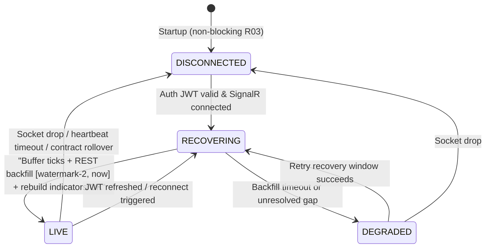
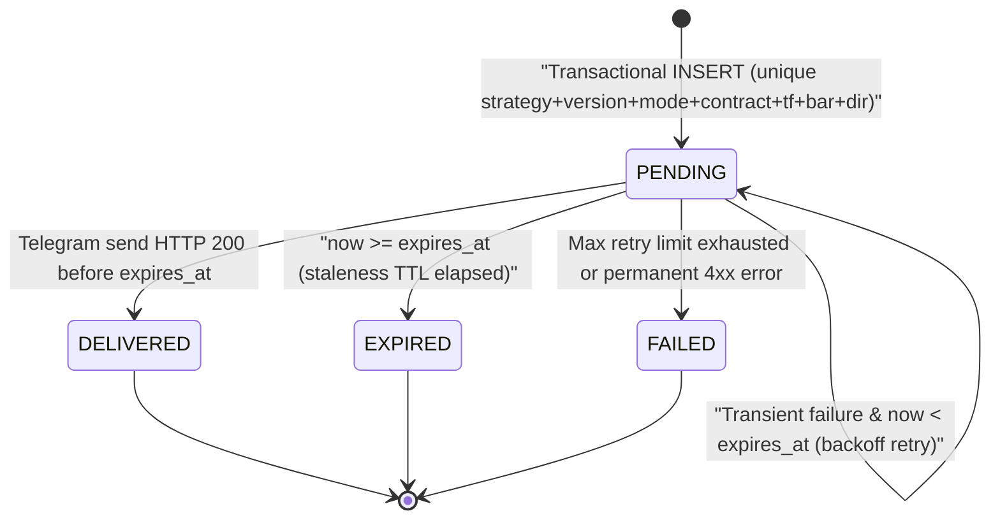
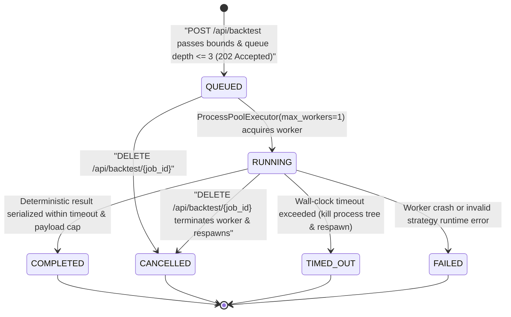
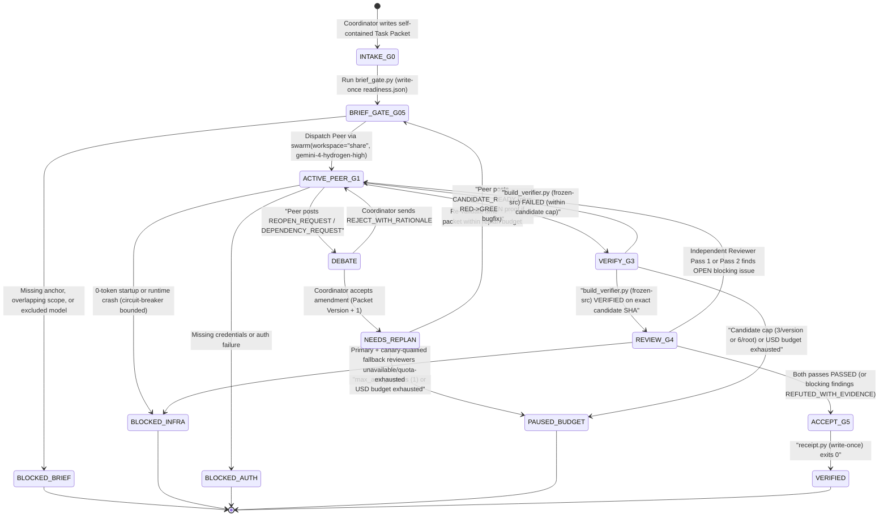

# System Statecharts (`topstep-chart-app`)

> Critical state machines requiring explicit transitions, invariants, and verification before shipping.

---

## 1. SignalR Market Feed & Reconnect Recovery (`F03`, Phase 2)

**Invariants**:
- Live Telegram Strategy Scanner only emits actionable alerts in `LIVE` state.
- Signals detected while reconciling `RECOVERING` history are tagged `RECOVERED_HISTORICAL` and suppressed from live Telegram alerts.

---

## 2. Durable Telegram Alert Outbox (`F07`, Phase 2)

**Invariants**:
- Duplicate alert triggers on the same unique tuple hit SQLite `UNIQUE` constraint and no-op cleanly across restarts.
- Stale intraday signals (`now >= expires_at`) transition to `EXPIRED` and are never delivered late.

---

## 3. Isolated Backtest Job Worker (`R02`, Phase 5)

**Invariants**:
- FastAPI event loop and SignalR heartbeats are never blocked by backtest CPU execution.

---

## 4. S-L-P Task Delivery & Codex Room Review Gate (`G0–G5`)

