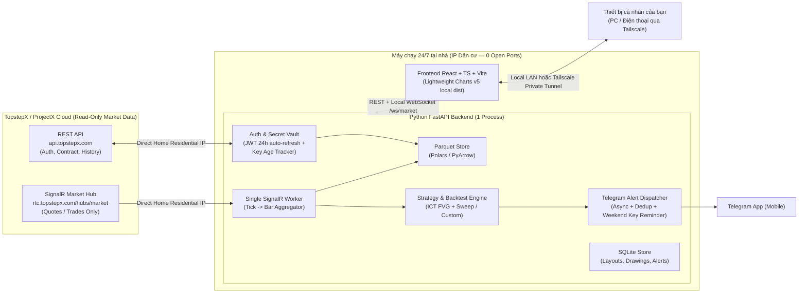

# Implementation Plan: TopstepX Futures Terminal (`topstep-chart-app`)

## Goal Description

Nâng cấp thư mục [topstep-chart-app/](file:///d:/01_DCMvn/Workspace/Lightchart/topstep-chart-app) (đặt song song và giữ sạch repo fork [lightweight-charts/](file:///d:/01_DCMvn/Workspace/Lightchart/lightweight-charts)) từ bản demo Node.js tạm thời thành một **nền tảng phân tích, vẽ biểu đồ, backtest, bar replay và bắn tín hiệu Telegram 24/7** cho 4 mã futures TopstepX (**MES, MNQ, MYM, MGC**) — tuân thủ tuyệt đối quy định Prop Firm (Topstep / ProjectX / CME) và đặt bảo mật API Key lên hàng đầu.

---

## Quyết định Kiến trúc Đã Chốt (Finalized Decisions)

| Hạng mục | Phương án đã chốt | Lý do chính |
| :--- | :--- | :--- |
| **Vị trí Codebase** | Nâng cấp trực tiếp trong `topstep-chart-app/` (song song với `lightweight-charts/`) | Giữ sạch repo fork TradingView để dễ `git pull upstream`, đồng thời dùng trực tiếp bản build `../lightweight-charts/dist/`. |
| **Backend** | **Python FastAPI + Polars/Parquet + SQLite + 1 kết nối SignalR** (quản lý bằng `uv`) | Tốc độ đọc/ghi Parquet ngang Rust (nhờ lõi Rust của Polars), kết nối SignalR gọn, viết indicator/backtest cực nhanh. |
| **Frontend** | **React + TypeScript + Vite** + `lightweight-charts` v5 | Quản lý mượt state phức tạp (Layout 1–8 khung, 5 Sync toggles, Toolbar vẽ, Bar Replay) trong khi Canvas vẫn chạy tách biệt qua `useRef`. |
| **Chiến lược mẫu đầu tiên** | **ICT FVG + Liquidity Sweep** (kiến trúc plugin `strategy_base.py`) | Kiểm chứng đủ 100% pipeline: Auto-FVG box, Markers Entry/Exit, đường nối lệnh, P&L theo `tickValue` và Telegram Alert. |
| **Vận hành 24/7 & Tuân thủ Prop Firm** | **100% Read-Only Market Data** + **Máy chạy 24/7 tại nhà** (PC / Mini PC / Pi dùng chung IP dân cư) + **Tailscale VPN** xem từ xa | Loại bỏ 100% rủi ro bị Topstep đánh cờ IP VPS/khác quốc gia, chi phí hosting **\$0/tháng**, 0 port mở, tuân thủ tuyệt đối CME Non-Professional (1 người dùng). |
| **Bảo mật & Xoay vòng API Key** | **Zero-Secret-in-Browser** + `APP_ENV=production` khóa nhập key qua web + **Soft Rotation Reminder** (`KEY_ROTATION_DAYS=30`, `KEY_ROTATION_ENFORCE=false`) | Không bao giờ lộ key xuống trình duyệt/log/git; nhắc đổi key qua Telegram vào cuối tuần khi sàn đóng cửa (có tùy chọn bật ngắt cứng nếu muốn). |

---

## Kiến trúc Tổng thể



---

## User Review Required

> [!IMPORTANT]
> **Thay thế hoàn toàn `server.mjs` bằng Python FastAPI**:
> File tạm `topstep-chart-app/server.mjs` sẽ được thay bằng `topstep-chart-app/backend/` (Python FastAPI + `uv`). Bản build cục bộ `../lightweight-charts/dist/lightweight-charts.standalone.production.js` tiếp tục được sử dụng làm engine biểu đồ.

> [!CAUTION]
> **Cam kết Tuân thủ Topstep / ProjectX (Hard Read-Only)**:
> Hệ thống **tuyệt đối không** chứa bất kỳ code nào gọi `/api/Order/*`, `/api/Position/*` hay `/hubs/user`. Ứng dụng chỉ đọc dữ liệu thị trường thụ động, vẽ biểu đồ, backtest và gửi cảnh báo Telegram. Mọi thao tác đặt/sửa/hủy lệnh thật đều do bạn tự thực hiện trên TopstepX từ máy cá nhân.

---

## Proposed Changes

### Cấu trúc thư mục mục tiêu trong `topstep-chart-app/`

```text
topstep-chart-app/
├── .env.example                 # Mẫu cấu hình an toàn (không chứa secret thật)
├── .gitignore                   # Chặn tuyệt đối .env, *.key, data/, *.parquet, *.db, .venv/
├── Dockerfile                   # Tùy chọn chạy gọn bằng Docker trên máy nhà / Mini PC
├── docker-compose.yml           # Compose cấu hình 1 service self-hosted cục bộ
├── backend/
│   ├── pyproject.toml           # Quản lý bằng uv (Python 3.12+)
│   ├── app/
│   │   ├── main.py              # FastAPI entrypoint + lifespan (SignalR + Key Rotation Check)
│   │   ├── config.py            # Pydantic Settings đọc .env an toàn
│   │   ├── security.py          # Auth guard, APP_ENV=production lockdown, log redaction, rate limit
│   │   ├── topstep/
│   │   │   ├── auth.py          # /api/Auth/loginKey + auto-refresh JWT < 23h + key age check
│   │   │   ├── rest_client.py   # Chỉ gồm /api/Contract/search & /api/History/retrieveBars (Read-Only)
│   │   │   └── signalr_hub.py   # 1 kết nối SignalR Market Hub duy nhất + reconnect backoff
│   │   ├── storage/
│   │   │   ├── parquet_store.py # Đọc/ghi/merge incremental Parquet bằng Polars (zstd)
│   │   │   └── sqlite_store.py  # Lưu Layout presets, Drawings, Alert history, Backtest runs
│   │   ├── engine/
│   │   │   ├── instruments.py   # Thông số chuẩn CME/TopstepX: tickSize & tickValue (MES/MNQ/MYM/MGC)
│   │   │   ├── bar_aggregator.py# Ghép tick/quote real-time thành nến 1m/5m/15m/1h/4h/1d
│   │   │   ├── indicators.py    # Auto-FVG, Auto-OrderBlock, Liquidity Sweep, EMA, VWAP, RSI
│   │   │   ├── strategy_base.py # Interface plugin cho mọi chiến lược Python
│   │   │   ├── strategies/
│   │   │   │   └── ict_fvg_sweep.py  # Chiến lược mẫu: ICT FVG + Liquidity Sweep
│   │   │   ├── backtester.py    # Chạy backtest trên Parquet -> markers + trade_lines + boxes + metrics
│   │   │   └── alert_engine.py  # Quét live bar + chống spam (dedup/cooldown)
│   │   ├── notify/
│   │   │   └── telegram.py      # Gửi alert Entry/SL/TP/R:R + nhắc xoay vòng key cuối tuần
│   │   └── api/
│   │       ├── routes_status.py # /api/status (trạng thái kết nối, key age badge — không lộ secret)
│   │       ├── routes_market.py # /api/contracts, /api/bars, WS /ws/market
│   │       ├── routes_layout.py # CRUD Layout presets (1-8 panes) + Drawings
│   │       ├── routes_backtest.py # Chạy backtest Python + cấp dữ liệu cho Bar Replay
│   │       └── routes_alerts.py # Bật/tắt strategy scanner + nút Test Telegram
│   └── tests/                   # Pytest unit tests (Parquet, Aggregator, ICT Backtester, Security)
├── frontend/
│   ├── package.json             # React + TypeScript + Vite
│   ├── tsconfig.json
│   ├── vite.config.ts           # Proxy /api & /ws sang FastAPI khi dev
│   └── src/
│       ├── store/               # Zustand state (Layout, Sync toggles, Active Tool, Replay state)
│       ├── layout/              # Layout Picker (1-8 panes, "4 Future") + Sync Controller (5 toggles)
│       ├── chart/               # Lightweight Charts v5 wrapper + Multi-pane + OHLCV Legend + Markers
│       ├── drawings/            # Series Primitives: Trendline, Ray, HLine, FVG Box, OB, Long/Short, Measure
│       ├── replay/              # Bar Replay (Play/Pause/Step/Speed + Sim Orders & Live P&L)
│       └── backtest/            # Backtest Viewer (Trade list, Equity, Markers, Entry-Exit Trade Lines)
└── data/
    ├── parquet/                 # MES_1m.parquet, MNQ_1m.parquet, MYM_1m.parquet, MGC_1m.parquet
    └── app.db                   # SQLite lưu layouts, drawings, alert history
```

---

### Module 1: Backend Parquet Store & Single SignalR Hub (`backend/`)

#### [DELETE] [server.mjs](file:///d:/01_DCMvn/Workspace/Lightchart/topstep-chart-app/server.mjs)
Xóa server Node.js tạm thời sau khi chuyển sang FastAPI.

#### [NEW] `backend/app/storage/parquet_store.py`
- Lưu cache dữ liệu lịch sử dạng `data/parquet/{SYMBOL}_{TF}.parquet` nén `zstd`.
- **Incremental Sync**:
  1. Đọc file Parquet hiện có bằng `polars.scan_parquet()`.
  2. Chỉ gọi TopstepX REST `/api/History/retrieveBars` cho khoảng thời gian mới/còn thiếu.
  3. Gộp, khử trùng theo `time`, sắp xếp tăng dần và ghi nguyên tử (ghi file tạm `.tmp` rồi `os.replace`) tránh hỏng dữ liệu.
- **Resample nhanh tại chỗ**: Hỗ trợ resample từ `1m` sang `3m`, `5m`, `15m`, `1H`, `4H` bằng `polars.group_by_dynamic()` trong vài mili-giây phục vụ backtest và Bar Replay không cần gọi lại API.

#### [NEW] `backend/app/topstep/signalr_hub.py`
- Mở **duy nhất 1 kết nối SignalR** tới `wss://rtc.topstepx.com/hubs/market?access_token=<JWT>` trong `FastAPI lifespan`.
- Subscribe đồng thời 4 hợp đồng active (`MES`, `MNQ`, `MYM`, `MGC`) qua `SubscribeContractQuotes` / `SubscribeContractTrades`.
- Tự động reconnect theo exponential backoff (2s → 4s → 8s → max 60s), tự làm mới JWT trước hạn 24h, và báo Telegram nếu mất kết nối quá 2 phút trong giờ sàn mở.
- Broadcast nến cập nhật qua 1 kênh WebSocket nội bộ `/ws/market` tới mọi khung biểu đồ trên trình duyệt.

---

### Module 2: Layout Setup (1–8 Panes) & Sync in Layout (`frontend/src/layout/`)

Thiết kế bám sát giao diện TradingView từ ảnh chụp bạn đã cung cấp:

- **Layout Picker Dropdown** (hiển thị tên layout như `4 Future` + icon lưới):
  - Hỗ trợ đầy đủ các template lưới từ **1 đến 8 khung** (`1x1`, `2 cols`, `2 rows`, 6 kiểu `3 panes`, 10 kiểu `4 panes` với `2x2` mặc định cho `4 Future`, đến các mẫu `5`, `6`, `7`, `8 panes`).
  - Cho phép **Lưu / Đổi tên / Xóa Layout** vào SQLite (ví dụ: `4 Future`, `MES Multi-TF`, `Scalp MNQ`).
- **SYNC IN LAYOUT (5 công tắc độc lập)**:
  1. **Symbol**: Bật để đồng bộ mã giao dịch trên mọi khung (phù hợp xem đa khung thời gian cùng 1 mã).
  2. **Interval**: Bật để đồng bộ khung thời gian trên mọi khung (phù hợp layout `4 Future`: MES/MNQ/MYM/MGC cùng `5m`).
  3. **Crosshair**: Rê chuột ở 1 khung sẽ di chuyển crosshair đồng bộ theo thời gian ở toàn bộ các khung còn lại (`chart.setCrosshairPosition`).
  4. **Time**: Click/nhảy tới 1 mốc thời gian sẽ căn giữa mốc đó trên toàn bộ các khung.
  5. **Date range**: Zoom/kéo trục thời gian ở 1 khung sẽ đồng bộ vùng thời gian hiển thị của tất cả các khung (`subscribeVisibleTimeRangeChange` có guard chống đệ quy).

---

### Module 3: Interactive Drawing Primitives (`frontend/src/drawings/`)

Xây dựng hoàn toàn trên **Lightweight Charts v5 Series Primitives (`ISeriesPrimitive`)**, kết hợp kiến trúc của `crypt0inf0/lightweight-charts-ui` & `bonguynvan/tradecanvas`:

- **Thanh công cụ vẽ bên trái**:
  - `Cursor` (chọn, di chuyển, kéo chỉnh điểm neo anchor).
  - `Trendline` & `Ray`.
  - `Horizontal Line` (mức giá ngang kèm nhãn giá trục phải).
  - `FVG Box` (preset Bullish xanh / Bearish đỏ + đường 50% CE - Consequent Encroachment).
  - `Order Block (OB)` (hộp chữ nhật kèm nhãn tùy chỉnh + tùy chọn Extend Right).
  - `Long / Short Position Tool` (Entry, SL, TP tương tác chuột, tự tính số tick, \$ rủi ro và tỷ lệ `R:R`).
  - `Measure Tool` (đo số bar, thời gian, khoảng giá & số tick).
  - `Magnet Mode` (hút điểm neo vào OHLC nến gần nhất) + `Delete / Clear`.
- **Lưu trữ bền vững**: Lưu JSON theo từng mã vào SQLite (`GET/POST/DELETE /api/drawings/{symbol}`) để F5 không mất và đồng bộ giữa PC & điện thoại.

---

### Module 4: Backtest Engine, Bar Replay & Telegram Alert (`backend/app/engine/` + `frontend/src/replay/` & `backtest/`)

#### 4A. Bar Replay UI (tham khảo `bonguynvan/tradecanvas`)
- **Replay Controls**: Chọn điểm bắt đầu trực tiếp bằng cách click trên chart, `Play / Pause`, `Step Forward (+1 bar)`, `Step Back (-1 bar)`, tốc độ `0.5x / 1x / 2x / 5x / 10x`.
- **Giả lập đặt lệnh trực tiếp khi Replay**: Hỗ trợ đặt lệnh Market hoặc kéo từ `Long/Short Position Tool` với SL/TP; tự động tính P&L chuẩn theo thông số CME/TopstepX:
  - `MES`: tickSize `0.25`, tickValue `\$1.25`
  - `MNQ`: tickSize `0.25`, tickValue `\$0.50`
  - `MYM`: tickSize `1.00`, tickValue `\$0.50`
  - `MGC`: tickSize `0.10`, tickValue `\$1.00`
- Bảng **Live Replay Stats**: Unrealized P&L, Realized P&L, Winrate, danh sách lệnh đã khớp.

#### 4B. Python Backtest Engine & Visualization (tham khảo `CharlesLehnen/LightweightCharts-for-Freqtrade`)
- Đọc thẳng từ Parquet cache, chạy chiến lược kế thừa `strategy_base.py` (cài sẵn chiến lược mẫu **`ICT FVG + Liquidity Sweep`**).
- Xuất payload chuẩn cho Frontend vẽ lại toàn bộ phiên backtest:
  - `markers`: `SeriesMarkers` mũi tên xanh/đỏ tại đúng cây nến Entry/Exit kèm nhãn P&L.
  - `trade_lines`: Primitive vẽ **đường nét đứt nối từ `(entry_time, entry_price)` đến `(exit_time, exit_price)`** (xanh nếu lãi, đỏ nếu lỗ).
  - `zones`: Các hộp **FVG / Liquidity level** mà chiến lược đã phát hiện (vẽ chung trên hệ thống Primitive).
  - `indicators`: Các chuỗi đường từ Polars DataFrame đồng bộ trục thời gian với nến chính.
  - `summary`: Net Profit (\$), Winrate (%), Profit Factor, Max Drawdown (\$), Total Trades, Equity Curve.

#### 4C. Live Strategy Scanner & Telegram Alert (`backend/app/notify/telegram.py`)
- Chạy trên mỗi cây nến đóng (hoặc trigger intrabar) từ luồng SignalR duy nhất.
- Khử trùng tín hiệu theo `(strategy_id, symbol, tf, bar_time, direction)`.
- Gửi tin nhắn Telegram tức thì (< 1s): mã, khung thời gian, hướng lệnh, lý do trigger (`Bullish FVG + Sweep`), `Entry / SL / TP / R:R`, giờ Việt Nam (`UTC+7`).

---

### Module 5: Vận hành 24/7, Tuân thủ Prop Firm & Chi phí Tối ưu

#### Phương án khuyến nghị số 1: Máy chạy 24/7 tại nhà + Tailscale (Tối ưu cả Tuân thủ & Chi phí)
- **Phần cứng**: Tận dụng máy tính đang có, laptop cũ, hoặc đầu tư 1 Mini PC (Intel N100) / Raspberry Pi chạy 24/7 ngay trên đường truyền Internet gia đình.
- **Chi phí vận hành hàng tháng**: **\$0/tháng** tiền VPS, **\$0/tháng** tiền tên miền/SSL, **\$0/tháng** Tailscale Personal (miễn phí tới 100 thiết bị), **\$0/tháng** Telegram Bot *(chỉ tốn tiền điện ~5–10W nếu dùng Mini PC/Pi, chưa tính gói TopstepX ProjectX API \$14.50/tháng)*.
- **Tài nguyên tiêu thụ thực tế**: ~180–350 MB RAM, CPU trung bình < 5%, lưu trữ Parquet ~30–60 MB/năm cho 4 mã futures.
- **Tuân thủ Prop Firm 100%**:
  - Outbound tới `api.topstepx.com` & `rtc.topstepx.com` đi thẳng từ **IP dân cư tại nhà** (trùng khớp IP bạn giao dịch hằng ngày, không qua VPN/VPS datacenter).
  - Tailscale chỉ tạo đường hầm riêng để điện thoại/laptop của bạn xem giao diện web từ xa.
  - Chỉ 1 người dùng duy nhất (chính bạn) → không vi phạm điều khoản tái phân phối dữ liệu CME.

*(Lưu ý: Vẫn cung cấp sẵn `Dockerfile` + `docker-compose.yml` để bạn có thể chạy gọn bằng Docker trên Mini PC/Ubuntu tại nhà nếu muốn).*

---

### Module 6: Kiến trúc Bảo mật & Xoay vòng API Key (Ưu tiên hàng đầu)

1. **Zero-Secret-in-Browser**:
   - `TOPSTEPX_USERNAME`, `TOPSTEPX_API_KEY`, `TELEGRAM_BOT_TOKEN`, `TELEGRAM_CHAT_ID` chỉ tồn tại trong file `.env` trên máy chủ (`chmod 600`), **không bao giờ** xuất hiện trong response API, JS bundle hay `localStorage`.
2. **Production Lockdown (`APP_ENV=production`)**:
   - Khi chạy 24/7, tắt hoàn toàn endpoint nhận API Key từ giao diện web — chỉ nạp từ `.env` cục bộ lúc khởi động.
3. **Log & Exception Redaction**:
   - Mọi logger và error handler tự động che (`***REDACTED***`) các chuỗi `Authorization`, `access_token`, `apiKey`, `token`.
4. **Chính sách Xoay vòng API Key (Soft Rotation Reminder — Linh hoạt)**:
   - Cấu hình trong `.env`:
     - `TOPSTEPX_KEY_UPDATED_AT=YYYY-MM-DD`
     - `KEY_ROTATION_DAYS=30` *(có thể chỉnh thành `15` theo ý bạn)*
     - `KEY_ROTATION_ENFORCE=false` *(mặc định chỉ nhắc nhở, **không ngắt cứng giữa phiên trade**)*
   - Khi tới hạn `KEY_ROTATION_DAYS`:
     - Backend gửi **nhắc nhở qua Telegram vào cuối tuần** (Thứ 7/Chủ Nhật khi sàn CME đóng cửa) để bạn lên `topstepx.com/settings?tab=api` tạo key mới mà không gián đoạn giao dịch.
     - Thanh trạng thái trên web hiển thị badge màu vàng (`Key age: 30d`).
   - Nếu bạn muốn kỷ luật khóa cứng bắt buộc thay key khi tới hạn, chỉ cần đổi `KEY_ROTATION_ENFORCE=true` trong `.env`.
5. **0 Open Ports**:
   - Không mở bất kỳ cổng nào trên router ra Internet công cộng; chỉ lắng nghe loopback (`127.0.0.1`) hoặc interface Tailscale riêng kèm xác thực caller (xem F01 bên dưới).

---

### Module 7: Chart Agent Workspace & MCP Integration (`backend/app/agent/` + `backend/app/mcp/` + `frontend/src/agent/`)

Cho phép AI Agent **cùng làm việc trực tiếp trên chart với người dùng** (đọc chung ngữ cảnh, vẽ/sửa object theo quy tắc mô tả tự nhiên, viết & kiểm thử indicator Python an toàn) trong khi vẫn **giữ cứng giới hạn Read-Only với tài khoản giao dịch thật TopstepX** (không bao giờ gọi lệnh đặt/sửa/hủy thật).

#### 7.1. Shared Chart Context Service (Ngữ cảnh dùng chung)
- Duy trì **Shared Chart State** tập trung tại backend (đồng bộ hai chiều với Frontend qua WebSocket và phơi bày cho Agent qua MCP):
  - `workspace_id`, `active_pane_id`, `contract_id`, `root_symbol`, `timeframe`, `live_mode` (`live`/`sim`), `playback_mode` (`live`/`replay`).
  - `visible_time_range` (`from`, `to`), `replay_cursor_time` (nếu đang Replay — chặn rò rỉ dữ liệu sau con trỏ), và `selected_object_ids`.
  - Danh sách dữ liệu OHLCV đang hiển thị, các indicator đang bật, và toàn bộ drawing objects.
  - **Định danh ổn định cho mọi Object**: `{ id, revision, type, pane_id, contract_id, created_by ("user" | "agent"), source_bar_refs, coordinates (time-price), style, metadata }`.
- Đảm bảo Agent tham chiếu chính xác các cụm từ ngữ cảnh như *"rectangle đang chọn"*, *"đường SL của lệnh giả lập này"*, hoặc *"vùng FVG số 2"*.

#### 7.2. MCP Server & Tool Schema (`backend/app/mcp/server.py`)
Cung cấp bộ MCP tools có schema JSON chặt chẽ (chạy qua stdio/local SSE gắn với cùng `ChartContextService` và `CommandService`):

| Nhóm | MCP Tools | Ghi chú kỹ thuật |
| :--- | :--- | :--- |
| **Đọc ngữ cảnh** | `get_chart_context`, `get_bars`, `list_chart_objects`, `get_selected_objects` | Dữ liệu có cấu trúc (JSON time–price) là **nguồn chân lý chính**; tôn trọng `replay_cursor_time`. |
| **Vẽ và sửa** | `create_chart_objects`, `update_chart_objects`, `delete_chart_objects` | Mọi rectangle/line/zone lưu theo **tọa độ `(time, price)`**, tuyệt đối không lưu theo pixel. |
| **Đối chiếu hình ảnh** | `capture_chart` | Chụp ảnh canvas hiện tại phục vụ quan sát trực quan bổ trợ (không dùng thay tọa độ cấu trúc). |
| **Kiểm tra indicator** | `validate_indicator`, `run_indicator_preview` | Chạy thử code Python trong worker cô lập; trả về lỗi/preview trước khi áp dụng thật. |
| **Hiển thị indicator** | `apply_indicator`, `remove_indicator` | Đẩy chuỗi line/marker/rectangle chuẩn hóa xuống Lightweight Charts Series Primitives. |

#### 7.3. Chuyển mô tả tự nhiên thành Đặc tả Quy tắc Kiểm chứng được
- Trước khi vẽ hoặc sinh indicator, Agent chuẩn hóa mô tả tự nhiên của người dùng thành **Rule Spec JSON** gồm:
  - `detection_rule` (điều kiện phát hiện, ví dụ: Bullish FVG 3 nến `low[i] > high[i-2]`).
  - `confirmation_timing` (`on_bar_close` vs `intrabar`, kèm cờ `repaint_allowed: false` mặc định).
  - `zone_coordinates` (điểm neo thời gian–giá), `extension_policy` (`until_50pct_touch` / `until_invalidation` / `fixed_bars`), `touch_invalidation_rule`.
- Phân biệt rõ 2 chế độ:
  1. **One-off Draw**: Vẽ tĩnh các object lên dữ liệu hiện tại (`created_by: "agent"`).
  2. **Live Indicator**: Biến quy tắc thành indicator Python tự cập nhật khi có nến mới đóng.

#### 7.4. Viết & Chạy Indicator An toàn (Isolated Python Worker)
- Ưu tiên **indicator Python ở backend** (xuất dữ liệu chuẩn hóa `{ lines, markers, boxes }` để Frontend vẽ qua Lightweight Charts Series Primitives). Chưa mặc định hỗ trợ Pine Script.
- **Sandbox cô lập cho code Agent tạo**:
  - Chạy trong **subprocess worker tách biệt** khỏi tiến trình FastAPI / SignalR chính (lỗi hoặc vòng lặp vô hạn không thể chặn market feed).
  - Áp giới hạn cứng về **CPU time / wall-clock timeout** (ví dụ 5s), **RAM**, **không truyền biến môi trường/secrets**, **tắt truy cập mạng**, chỉ cấp dữ liệu OHLCV dạng read-only input và chặn truy cập filesystem tùy ý (AST whitelist + import restriction).
  - Bắt buộc qua bước `validate_indicator` → `run_indicator_preview` (hiển thị kết quả/lỗi xem trước) trước khi `apply_indicator` thay thế phiên bản đang dùng.

#### 7.5. Unified Command Service, Concurrency & Undo/Redo
- Mọi thay đổi từ **người dùng (UI)** và **Agent (MCP)** đều đi qua **cùng một `CommandService`**, được lưu SQLite và broadcast qua WebSocket về chart:
  - Mỗi batch thay đổi gắn `expected_revision` (Optimistic Concurrency Control) và `idempotency_key`.
  - Từ chối (`409 Conflict`) nếu Agent gửi lệnh sửa dựa trên `revision` cũ hơn trạng thái mới nhất của người dùng (tránh ghi đè thao tác vừa làm).
  - Lưu lịch sử command stack hỗ trợ **Undo / Redo** đầy đủ cho cả thao tác tay lẫn batch do Agent tạo.

#### 7.6. Tham khảo Kiến trúc
- **`CopilotKit/CopilotKit`** (kết hợp React + Lightweight Charts): Học mô hình giao tiếp 2 chiều `useCopilotReadable` (phơi bày trạng thái chart/selection/visible range theo thời gian thực) và `useCopilotAction` (kích hoạt lệnh điều khiển Series Primitives trên chart).
- **`OpenBB-finance/OpenBB` (OpenBB Workspace / Copilot)**: Học kiến trúc **Widget Context Sharing** (schema ngữ cảnh chuẩn cho từng pane/widget) và luồng AI viết code Python phân tích dữ liệu đang hiển thị rồi trả ngược thành lớp overlay mới trên giao diện.

#### 7.7. Kiểm thử bắt buộc cho Module 7
- Agent và người dùng nhìn đúng cùng `object_id` & `data_revision`.
- Tọa độ `(time, price)` của rectangle/line do Agent vẽ giữ nguyên chính xác sau khi zoom, pan hoặc đổi layout 1–8 khung.
- Undo/Redo khôi phục trọn vẹn từng batch thay đổi của Agent; lệnh mang `expected_revision` cũ bị từ chối.
- Ở chế độ Bar Replay, `get_bars` / `run_indicator_preview` tuyệt đối không trả về nến sau `replay_cursor_time`.
- Indicator chứa lỗi cú pháp, vòng lặp vô hạn hoặc cố đọc `.env`/mạng bị sandbox chặn mà không làm gián đoạn SignalR market feed.
- Xác nhận không tồn tại bất kỳ MCP tool hay backend route nào chạm tới đặt/sửa/hủy lệnh thật trên TopstepX.

---

## Lộ trình Triển khai theo Giai đoạn (Phased Delivery)

- **Phase 1 — Backend FastAPI + Parquet Cache + Security & Contract Integrity (F01, F02, F04, F05)**:
  - Khởi tạo `backend/` bằng `uv`, thay thế `server.mjs`.
  - Áp dụng **Caller Auth boundary** (session cookie `HttpOnly`/`SameSite=Strict`, CSRF token cho mutations, Host/Origin validation, bind loopback/Tailscale interface — **F01**).
  - Loại bỏ wrong-symbol fallback; định danh storage theo `(provider, live_mode, contract_id, timeframe)` (**F02**).
  - Triển khai **Parquet Store** có paginated backfill, coverage metadata, tách provisional/closed bars (**F04**), và `asyncio.Lock` per-dataset + unique temp files (**F05**).
  - Key Rotation Tracker + Log Redaction + `pytest` unit tests.
- **Phase 2 — Single SignalR Real-Time Hub + Reconnect Reconciliation + Durable Telegram Outbox (F03, F07)**:
  - Kết nối `wss://rtc.topstepx.com/hubs/market` với máy trạng thái `DISCONNECTED -> RECOVERING -> LIVE`, per-contract closed-bar watermarks, bounded event buffer, overlapping REST backfill & state rebuild trước khi bật lại scanner (**F03**).
  - SQLite transactional **Alert Outbox** có `expires_at` TTL, `contract_id` + `strategy_version` trong unique key, bounded retry và trạng thái `PENDING / DELIVERED / EXPIRED / FAILED` (**F07**).
- **Phase 3 — Frontend React+TS+Vite + Layout Setup (1–8 Panes) & Sync in Layout (F06)**:
  - Dựng giao diện TradingView-style, Layout Picker `1–8 panes` (`4 Future`), 5 công tắc `SYNC IN LAYOUT` (`Symbol`, `Interval`, `Crosshair`, `Time`, `Date range`), lưu layout vào SQLite.
  - Áp dụng `AbortController` + `(pane_id, contract_id, timeframe, mode, generation)` ownership guard chặn stale responses (**F06**).
- **Phase 4 — Interactive Drawing Primitives**:
  - Toolbar vẽ trái: Trendline, Ray, HLine, **FVG Box (kèm 50% CE)**, **Order Block**, **Long/Short Position Tool**, Measure, Magnet + lưu/khôi phục SQLite qua Unified `CommandService` (có `revision` & Undo/Redo).
- **Phase 5 — Bar Replay + Python Backtest (`ICT FVG + Sweep`) + Self-Hosted 24/7 Kit (F08)**:
  - Bar Replay (`Play/Pause/Step/Speed` + rewind từ checkpoint + đặt lệnh giả lập & P&L theo `tickValue`), Python Backtest Runner có quy tắc causality (không look-ahead, zone `detected_at`, deterministic conservative both-hit SL/TP policy — **F08**), vẽ `markers` + `trade_lines` + `zones` + `indicators`, `Dockerfile` / `docker-compose.yml` và hướng dẫn chạy 24/7 tại nhà + Tailscale.
- **Phase 6 — Chart Agent Workspace & MCP Integration (Module 7)**:
  - Triển khai `ChartContextService`, Unified `CommandService` (revision + idempotency + undo/redo), MCP Server (`get_chart_context`, `get_bars`, CRUD objects, `capture_chart`, `validate_indicator`, `run_indicator_preview`, `apply_indicator`), Isolated Python Indicator Worker, và tích hợp panel Agent/Copilot trên Frontend.

---

## Verification Plan

### Automated Tests
1. **Backend (`pytest`)**:
   - `uv run --directory topstep-chart-app/backend pytest`
   - Kiểm tra:
     - `parquet_store`: ghi/đọc nguyên tử, incremental merge, khử trùng timestamp, resample `1m -> 5m/15m/1h`.
     - `bar_aggregator`: ghép tick real-time thành nến OHLCV chính xác.
     - `ict_fvg_sweep` & `backtester`: phát hiện FVG + Liquidity Sweep, tính P&L đúng `tickSize`/`tickValue` của MES/MNQ/MYM/MGC, sinh đúng `markers`, `trade_lines`, `zones`.
     - `security`: xác nhận không endpoint nào rò rỉ `apiKey`/`token`, log redaction hoạt động, `KEY_ROTATION_ENFORCE=true/false` hành xử đúng, và không tồn tại bất kỳ route đặt lệnh nào.
2. **Frontend (`pnpm` / `tsc` + `vite build`)**:
   - `pnpm --dir topstep-chart-app/frontend typecheck && pnpm --dir topstep-chart-app/frontend build`.

### Manual Verification
1. **Layout & Sync**: Chuyển đổi qua lại giữa 1, 2, 3, 4 (`2x2`), 6, 8 khung; kiểm thử từng công tắc trong 5 mục `SYNC IN LAYOUT` (`Symbol`, `Interval`, `Crosshair`, `Time`, `Date range`) và lưu/tải lại layout sau F5.
2. **Drawing Tools**: Vẽ Trendline, FVG Box, Order Block, Long/Short Position Tool, kéo chỉnh điểm neo, F5 tải lại trang xác nhận còn nguyên.
3. **Bar Replay & Backtest**: Chạy Bar Replay trên dữ liệu Parquet, đặt lệnh giả lập kiểm tra P&L; chạy chiến lược `ICT FVG + Liquidity Sweep` kiểm tra markers + đường nối Entry–Exit + hộp FVG tự động.
4. **Live SignalR & Telegram**: Kết nối API Key TopstepX thật trên mạng nhà, xác nhận nến nhảy live, test nút gửi Telegram về điện thoại và xác nhận truy cập từ xa qua Tailscale.

---

## Security & Reliability Audit Validation (F01–F08)

> **Validation Note**: Verified directly against [server.mjs](file:///d:/01_DCMvn/Workspace/Lightchart/topstep-chart-app/server.mjs), [index.html](file:///d:/01_DCMvn/Workspace/Lightchart/topstep-chart-app/index.html), and this implementation plan. Note that `@.cursor/rules/harness-mcp-bridge.mdc` does not exist in `d:/01_DCMvn/Workspace/Lightchart` and no Harness MCP is configured in this session; no Harness files were touched.

---

### Finding F01 — Caller authorization and browser-origin protection are underspecified

**Decision**: Accepted

**Why**
- **Evidence from code**:
  - [server.mjs](file:///d:/01_DCMvn/Workspace/Lightchart/topstep-chart-app/server.mjs#L202-L212) (`GET /api/status`) and [server.mjs](file:///d:/01_DCMvn/Workspace/Lightchart/topstep-chart-app/server.mjs#L239-L246) (`POST /api/disconnect`) perform zero caller authentication.
  - [server.mjs](file:///d:/01_DCMvn/Workspace/Lightchart/topstep-chart-app/server.mjs#L248-L290) (`/api/contracts`, `/api/bars`) only check `if (!session.token)`, which verifies the shared server-to-TopstepX JWT, not the HTTP caller.
  - [server.mjs](file:///d:/01_DCMvn/Workspace/Lightchart/topstep-chart-app/server.mjs#L350-L352) calls `server.listen(PORT)` without a host parameter, binding all interfaces (`0.0.0.0`/`::`) rather than `127.0.0.1`.
  - No `Host`, `Origin`, or CSRF token validation exists in `server.mjs`, and the prior Plan's `security.py` only named "Auth guard" without specifying an HTTP/WS enforcement contract.
- **Technical accuracy**: Exact match to both the current prototype and the Plan gap.
- **Real-world impact**: Any device on the same LAN (or any compromised peer on Tailscale) or a malicious browser tab via cross-origin/DNS-rebinding requests can inspect status, disconnect the shared TopstepX session, or invoke planned mutation routes (drawings, layouts, alerts, MCP commands). No TopstepX API key extraction is exposed.
- **Likelihood**: Medium — easy to trigger on a shared home LAN while bound to all interfaces; lower once bound strictly to loopback/Tailscale with ACLs.
- **Recommendation fit**: Fits cleanly into Phase 1 `backend/app/security.py` without conflicting with Tailscale or Read-Only compliance.

**Updated implementation plan**
- Bind FastAPI explicitly to `APP_BIND_HOST=127.0.0.1` by default (or explicit Tailscale IP when configured), never `0.0.0.0` blindly.
- Implement single-user app authentication (locally provisioned app password hashed with Argon2id in `.env` → `HttpOnly; SameSite=Strict` session cookie; `Secure` enabled automatically under HTTPS).
- Enforce the caller session dependency on **all** HTTP API routes and validate the session + `Origin` header during WebSocket `/ws/market` handshake before `accept()`.
- Require `X-CSRF-Token` on all mutating HTTP requests (`POST`/`PUT`/`PATCH`/`DELETE`) and enforce strict `AllowedHost` + `AllowedOrigin` allowlists.
- Restrict any dev-only credential-entry route strictly to `APP_ENV=development` AND loopback client IP (`127.0.0.1` / `::1`).

**Tóm tắt tiếng Việt**
- **Chấp nhận (Accepted)**: `server.mjs` hiện lắng nghe mọi giao diện mạng và không xác thực người gọi (chỉ kiểm tra token TopstepX dùng chung). Phase 1 sẽ khóa bind interface, bổ sung xác thực phiên ứng dụng cho cả HTTP/WS, kiểm tra `Host`/`Origin` và bảo vệ CSRF cho mọi mutation.

---

### Finding F02 — Contract identity can silently change or be mixed across rollover

**Decision**: Accepted

**Why**
- **Evidence from code**:
  - [server.mjs](file:///d:/01_DCMvn/Workspace/Lightchart/topstep-chart-app/server.mjs#L159-L177) `pickBestContract()` line 174: `const pool = exactSymbol.length > 0 ? exactSymbol : contracts;` silently falls back to unrelated search results when no exact symbol matches, then picks `active || pool[0]`.
  - Plan Module 1 previously named Parquet files `{SYMBOL}_{TF}.parquet` (e.g., `MES_1m.parquet`) and deduplicated by `time` alone, collapsing contract expiry (`CON.F.US.MES.Z26` vs `H27`) and `live_mode` (`live=true` vs `false`).
- **Technical accuracy**: Exact match to both `server.mjs:159-177` and Plan Module 1.
- **Real-world impact**: High — silent price jumps across quarterly contract rollovers or mixed Sim/Live data corrupt FVG/OB detection, backtest P&L, and live Telegram alerts.
- **Likelihood**: Medium — rollover occurs every quarter (MES/MNQ/MYM) and bi-monthly (MGC); wrong-symbol fallback can trigger whenever search returns partial matches.
- **Recommendation fit**: Directly aligns with `parquet_store.py` and `instruments.py` in Phase 1.

**Updated implementation plan**
- Remove the fallback to unrelated contracts in `rest_client.py`; match strictly on verified `symbolId` / contract root metadata and raise a typed `ContractNotFoundError` / `AmbiguousContractError` if unresolved.
- Key Parquet storage and in-memory caches strictly by `(provider, live_mode, contract_id, timeframe)` — e.g., `data/parquet/topstepx/{sim|live}/{contract_id}/{tf}.parquet` — and include `contract_id`, `root_symbol`, `live_mode` in dataset metadata.
- Keep `root_symbol` (`MES`, `MNQ`, `MYM`, `MGC`) as display/grouping metadata; on active-contract rollover, unsubscribe the old `contract_id`, backfill the new `contract_id`, reset live strategy/indicator buffers, and log/notify the rollover event.

**Tóm tắt tiếng Việt**
- **Chấp nhận (Accepted)**: `pickBestContract` hiện có nhánh fallback sang mã không liên quan, và khóa lưu Parquet cũ theo `{SYMBOL}_{TF}` sẽ trộn dữ liệu khi đáo hạn hợp đồng (rollover) hoặc đổi Sim/Live. Phase 1 sẽ tách khóa lưu theo `(provider, live_mode, contract_id, timeframe)` và báo lỗi rõ nếu không khớp mã.

---

### Finding F03 — Reconnect does not specify recovery of missed market data

**Decision**: Accepted

**Why**
- **Evidence from code**:
  - `signalr_hub.py` does not exist yet. In the prior Plan, Module 1 defined exponential backoff reconnect, JWT refresh, and a 2-minute disconnect Telegram alert, while Module 4C consumed live bars — with no defined recovery/backfill sequence between reconnect and resuming live alerts.
- **Technical accuracy**: Accurate design gap in the Plan.
- **Real-world impact**: High — missed candles during a home ISP blip leave EMA/VWAP/FVG/Sweep buffers stale, causing missed or false Telegram entry alerts while the UI claims "Connected".
- **Likelihood**: High — home residential connections experience periodic micro-drops, router reboots, and nightly maintenance over 24/7 operation.
- **Recommendation fit**: Fits cleanly into Phase 2 `signalr_hub.py` + `bar_aggregator.py` + `routes_status.py`.

**Updated implementation plan**
- Implement an explicit feed state machine per contract: `DISCONNECTED` → `RECOVERING` → `LIVE` (plus `DEGRADED` on recovery failure).
- Maintain a persistent `last_closed_bar_time` watermark per `(live_mode, contract_id, tf)`.
- On SignalR reconnect: resubscribe first and buffer incoming ticks into a bounded `asyncio.Queue`, backfill an overlapping REST bar window (`[watermark - 2 bars, now]`), reconcile historical closed bars over buffered live ticks deterministically, rebuild indicator/strategy state, and only then transition to `LIVE` and re-enable Telegram alerts.
- Keep recovered historical signals logged as `RECOVERED_HISTORICAL` (never fired as actionable live Telegram entries).
- Expose `feed_state`, `last_event_age_sec`, `recovery_duration_ms`, `unresolved_gaps`, and `queue_overflow_count` in `/api/status`.

**Tóm tắt tiếng Việt**
- **Chấp nhận (Accepted)**: Kết nối lại SignalR không tự bù các cây nến bị mất khi rớt mạng nhà. Phase 2 sẽ bổ sung máy trạng thái `DISCONNECTED -> RECOVERING -> LIVE`, bù nến lịch sử qua REST, dựng lại trạng thái indicator trước khi bật lại scanner và hiển thị rõ trạng thái sẵn sàng dữ liệu.

---

### Finding F04 — Historical responses can be treated as complete despite truncation or partial candles

**Decision**: Accepted

**Why**
- **Evidence from code**:
  - [server.mjs](file:///d:/01_DCMvn/Workspace/Lightchart/topstep-chart-app/server.mjs#L297-L336) performs a single `/api/History/retrieveBars` request with `limit` (default 500, capped at 20,000) and `includePartialBar: true`, returning `{ contractId, count, bars }` with no truncation indicator, coverage intervals, or `is_closed` flag.
  - Plan Module 1 incremental sync only compared `max(time)` without paginated windowing or distinguishing open provisional bars from finalized closed bars.
- **Technical accuracy**: Exact match to `server.mjs:297-336` and Plan Module 1.
- **Real-world impact**: Medium — long backtest ranges silently truncate at `limit`, and persisting an open provisional candle as finalized causes shifting/non-reproducible backtest results.
- **Likelihood**: Medium — guaranteed when requesting >20,000 `1m` bars (~14+ trading days) or syncing during an active candle.
- **Recommendation fit**: Fits cleanly into Phase 1 `rest_client.py` and `parquet_store.py`.

**Updated implementation plan**
- Implement bounded paginated windowing in `rest_client.py` when fetching historical ranges, stopping only when requested bounds are covered or upstream returns empty/non-progressing timestamps (with explicit `truncated` / `provider_gap` quality flags).
- Track covered intervals `[start_ts, end_ts]` in SQLite metadata rather than assuming continuity from `max(time)`.
- Add `is_closed: bool` to bar schema; keep the current open candle provisional (mutable/overwritable in memory or flagged `is_closed=False`) and exclude provisional bars from closed-bar backtests and closed-bar strategies by default.

**Tóm tắt tiếng Việt**
- **Chấp nhận (Accepted)**: `server.mjs` chỉ gọi 1 lần `retrieveBars` kèm `includePartialBar: true` nên có thể thiếu dữ liệu khi vượt `limit` và lưu nhầm nến chưa đóng. Phase 1 sẽ phân trang cửa sổ thời gian, theo dõi khoảng phủ dữ liệu và tách rõ nến đang chạy (`is_closed=False`) khỏi nến đã đóng.

---

### Finding F05 — Atomic replacement alone does not prevent concurrent cache updates from losing data

**Decision**: Accepted

**Why**
- **Evidence from code**:
  - `parquet_store.py` does not exist yet. Plan Module 1 prescribed `read → merge → .tmp → os.replace` without specifying per-dataset write serialization or unique temporary filenames.
- **Technical accuracy**: Accurate design gap; in FastAPI, concurrent `/api/bars` backfills and the background SignalR persistence task can interleave read-modify-write cycles on the same Parquet file.
- **Real-world impact**: Medium — lost historical or live bars and potential `.tmp` filename collisions on Windows (`os.replace` also fails on Windows if another handle holds the temp file).
- **Likelihood**: Medium — likely whenever a user loads/scrolls history while live persistence flushes a closed bar.
- **Recommendation fit**: Minimal complexity, cleanly fits Phase 1 `parquet_store.py` within the single-process FastAPI architecture.

**Updated implementation plan**
- Route all Parquet writes through a single `ParquetStore` service holding an `asyncio.Lock` keyed by `(provider, live_mode, contract_id, timeframe)` covering the entire `read → merge → write temp → os.replace` critical section.
- Use `tempfile.NamedTemporaryFile(dir=target.parent, suffix=".tmp", delete=False)` for unique temporary filenames per write, ensuring file handles are closed before `os.replace()` (Windows-safe) and cleaned up in `except`/`finally`.
- Document and enforce the single-process (`uvicorn --workers 1`) constraint in startup/Docker config.

**Tóm tắt tiếng Việt**
- **Chấp nhận (Accepted)**: Chỉ dùng `os.replace` không tránh được mất dữ liệu khi 2 luồng cùng đọc-gộp-ghi 1 file Parquet. Phase 1 sẽ thêm `asyncio.Lock` theo từng dataset, tạo file tạm tên duy nhất (an toàn trên Windows) và khóa cấu hình chạy 1 process duy nhất.

---

### Finding F06 — Stale chart requests overwrite newer selections

**Decision**: Accepted

**Why**
- **Evidence from code**:
  - [index.html](file:///d:/01_DCMvn/Workspace/Lightchart/topstep-chart-app/index.html#L628-L682) `loadBarsForSymbol()` performs `fetch(url)` without `AbortController` or a request-generation token and unconditionally calls `entry.candleSeries.setData(candles)` upon resolution.
  - [index.html](file:///d:/01_DCMvn/Workspace/Lightchart/topstep-chart-app/index.html#L689-L702) `resetAutoRefresh()` triggers overlapping fetches every 15s, and [index.html](file:///d:/01_DCMvn/Workspace/Lightchart/topstep-chart-app/index.html#L714-L721) `tfTabs` triggers immediate fetches on timeframe click.
- **Technical accuracy**: Exact match to `index.html:628-721`.
- **Real-world impact**: Medium — an older slow response overwrites a newly chosen timeframe or contract, displaying bars that do not match the pane header or drawn objects.
- **Likelihood**: High — easily triggered during rapid timeframe switching (`1m` → `5m` → `15m`) or when auto-refresh overlaps a manual switch.
- **Recommendation fit**: Essential for Phase 3 React/TS multi-pane frontend (up to 8 panes).

**Updated implementation plan**
- Assign each pane an incrementing `requestGeneration` counter and store an `AbortController` per pane.
- Abort any in-flight request when `(contract_id, timeframe, live_mode, playback_mode)` changes, and before applying any response verify that `(pane_id, contract_id, timeframe, live_mode, generation)` still matches current store state; discard stale responses silently.

**Tóm tắt tiếng Việt**
- **Chấp nhận (Accepted)**: `index.html` hiện chưa hủy request cũ hay kiểm tra thứ tự response, dễ bị nến của khung thời gian cũ ghi đè lên khung mới chọn. Phase 3 sẽ dùng `AbortController` kết hợp kiểm tra `(pane_id, contract_id, timeframe, mode, generation)` trước khi render.

---

### Finding F07 — Alert deduplication is not defined across restart or delivery failure

**Decision**: Modified

**Why**
- **Evidence from code**:
  - `alert_engine.py` and `telegram.py` do not exist yet. Plan Module 4C specified an in-concept dedup tuple `(strategy_id, symbol, tf, bar_time, direction)` and SQLite alert history, without transactional outbox, crash-recovery, or staleness expiry rules.
- **Technical accuracy**: The persistence and crash-recovery gap is accurate, **and** for live trading alerts there is an additional domain constraint: retrying an entry alert indefinitely after an outage is unsafe if the signal is already stale.
- **Real-world impact**: Medium — duplicate alerts after restart reduce trust, while late alerts delivered minutes after an outage can mislead manual execution.
- **Likelihood**: Medium — restarts and transient Telegram/network timeouts are expected in 24/7 home operation.
- **Recommendation fit**: Fits cleanly into Phase 2 SQLite outbox + `telegram.py`.

**Corrected finding**
Alert deduplication and delivery state must be persisted transactionally in SQLite with a **contract- and version-scoped unique key** plus an **explicit staleness TTL (`expires_at`)**, so transient failures retry only while the signal is still actionable and expire cleanly afterward rather than firing late entry notifications.

**Updated implementation plan**
- Create an `alert_outbox` table in SQLite with a `UNIQUE` constraint on `(strategy_id, strategy_version, live_mode, contract_id, timeframe, bar_time, direction)`.
- Insert pending alerts transactionally before calling Telegram with status `PENDING` and `expires_at = created_at + ALERT_TTL_SECONDS` (default 90s for intraday entries).
- Background dispatcher retries `PENDING` rows with bounded backoff (e.g., 2s, 5s, 15s) only while `now < expires_at`, transitioning rows to `DELIVERED`, `EXPIRED`, or `FAILED` (preserving full audit history across restarts).

**Tóm tắt tiếng Việt**
- **Điều chỉnh (Modified)**: Đồng ý với vấn đề thiếu outbox bền vững trong SQLite khi restart/lỗi mạng, đồng thời bổ sung thêm **thời hạn hết hiệu lực (`expires_at` TTL)** để không bắn lại tín hiệu entry quá cũ sau khi mất mạng, và đưa `contract_id` + `strategy_version` vào khóa chống trùng.

---

### Finding F08 — Replay/backtest causality and ambiguous fills are undefined

**Decision**: Accepted

**Why**
- **Evidence from code**:
  - `backtester.py` and the Replay module do not exist yet. Plan Modules 4A–4B described Step Back (`-1 bar`), simulated orders with SL/TP, and backtest overlays (`markers`, `trade_lines`, `zones`), while the Verification Plan only checked detection and P&L arithmetic — omitting look-ahead prevention, zone visibility timestamps, intrabar SL/TP tie-breaking, and rewind state reconstruction.
- **Technical accuracy**: Accurate design gap for both Backtest and Bar Replay (and directly overlaps with Module 7's requirement that Agent/Replay never leak future data).
- **Real-world impact**: Medium — look-ahead bias or optimistic both-hit fills produce materially inflated backtest metrics and invalid replay practice.
- **Likelihood**: Medium — naturally arises on volatile `MES`/`MNQ` candles and whenever a user uses Step Back during replay.
- **Recommendation fit**: Fits directly into Phase 5 `backtester.py` + `replay/` and Phase 6 `ChartContextService`.

**Updated implementation plan**
- **Causality contract**: Closed-bar strategies evaluated at bar `i` close can only fill at `bar[i+1].open` (or a limit price strictly touched on `bar >= i+1`); never allow fills at `bar[i].close` from future information.
- **Zone visibility**: Every FVG/OB/Liquidity zone carries `detected_at_time` (the confirmation bar timestamp, e.g. bar 3 close for a 3-candle FVG). Both Bar Replay and MCP `get_bars`/`list_chart_objects` strictly filter out any bar or zone with `detected_at_time > replay_cursor_time`.
- **Deterministic both-hit SL/TP policy**: When a single OHLC bar touches both SL and TP, default to **conservative (SL hit first)**, record `ambiguous_fill=true` on the trade, and surface an ambiguous-fill count in backtest summary metrics.
- **Replay rewind**: Maintain an immutable action log `(bar_index, action)` and periodic state checkpoints; `Step Back (-1 bar)` reconstructs positions, realized/unrealized P&L, and active orders deterministically from the nearest checkpoint ≤ target bar.

**Tóm tắt tiếng Việt**
- **Chấp nhận (Accepted)**: Cần quy định rõ tính nhân quả để backtest và Bar Replay không bị rò rỉ dữ liệu tương lai. Phase 5 sẽ áp dụng nguyên tắc khớp lệnh sớm nhất ở nến `i+1`, gắn mốc `detected_at_time` cho mọi vùng FVG/OB, chọn quy tắc bảo thủ (chạm SL trước + gắn cờ `ambiguous_fill`) khi cùng 1 nến chạm cả SL và TP, và tái tạo trạng thái từ checkpoint khi bấm Step Back.

---

## Security & Reliability Audit Validation — Pass 2 (R01–R06)

> **Validation Note**: Verified directly against [server.mjs](file:///d:/01_DCMvn/Workspace/Lightchart/topstep-chart-app/server.mjs), [index.html](file:///d:/01_DCMvn/Workspace/Lightchart/topstep-chart-app/index.html), and this implementation plan. No Harness files were touched.

---

### Finding R01 — Generated Python isolation lacks an enforceable security boundary

**Decision**: Modified

**Why**
- **Evidence from code**:
  - Plan §7.4 specifies subprocess separation, AST whitelist/import restriction, clearing env secrets, and network/FS limits, but does not name an OS-enforced isolation mechanism.
  - The current local development machine is Windows without Docker installed (`docker` not found), while the target 24/7 home host supports Linux/Docker.
- **Technical accuracy**: The core security diagnosis is completely accurate — Python AST/import filtering inside a normal same-user subprocess is bypassable and cannot be treated as a real security boundary protecting `.env` (TopstepX API key, Telegram token) or SQLite/Parquet files.
- **Real-world impact**: High if arbitrary Agent-generated Python runs unsandboxed under the same OS user, because it could read `.env` or make outbound network requests.
- **Likelihood**: Medium once Phase 6 is enabled; zero prior to Phase 6.
- **Recommendation fit**: Requiring a full Linux OS sandbox unconditionally would block local Windows dev where Docker isn't installed. A **two-tier architecture** fits this project cleanly: (1) use a safe **declarative Rule Spec DSL** (evaluated by trusted backend code) as the default for Agent-created indicators, and (2) gate arbitrary Python execution behind an **OS-enforced container sandbox** that fails closed on unsupported hosts.

**Corrected finding**
Agent-generated Python indicator execution cannot rely on a plain subprocess + AST filter as a security boundary. Arbitrary generated Python must be gated behind an OS-enforced sandbox (e.g., ephemeral `--network=none --read-only` container with dropped privileges and no host secret/data mounts) and fail closed on hosts without that sandbox; routine Agent indicator requests should compile to a **declarative Rule Spec DSL** executed by trusted backend code so Phase 6 remains usable safely on both Windows dev and Linux 24/7 hosts.

**Updated implementation plan**
- **Tier 1 (Default — Safe Everywhere)**: Extend §7.3 so Agent indicator creation primarily outputs a validated **declarative Rule Spec JSON** (FVG, OB, Liquidity Sweep, EMA, VWAP, RSI, crossover/threshold/extension rules) executed by trusted `indicators.py` — zero arbitrary code execution.
- **Tier 2 (Opt-in Arbitrary Python — Fail-Closed OS Sandbox)**: Gate generated Python execution behind `AGENT_CUSTOM_CODE_ENABLED=false` (default off). When enabled, launch inside an OS-isolated container/sandbox (`--network=none`, `--read-only`, `--cap-drop=ALL`, unprivileged UID, `--memory=256m`, `--cpus=0.5`, `--pids-limit=32`, no `.env`/SQLite/Parquet mounts, OHLCV passed via stdin JSON, bounded stdout schema, wall-clock timeout killing the full process tree). Fail closed with a clear error if the OS sandbox runtime is unavailable.

**Tóm tắt tiếng Việt**
- **Điều chỉnh (Modified)**: Đúng là subprocess + lọc AST không đủ làm ranh giới bảo mật OS để bảo vệ `.env`. Kế hoạch cập nhật theo 2 tầng: (1) mặc định Agent tạo indicator qua **declarative Rule Spec JSON** chạy bằng hàm chuẩn an toàn trên cả Windows lẫn Linux; (2) nếu bật chạy code Python tự sinh (`AGENT_CUSTOM_CODE_ENABLED=true`), bắt buộc chạy trong **OS/container sandbox** (`--network=none --read-only`, không mount `.env`/data) và **fail-closed** nếu máy không có sandbox.

---

### Finding R02 — Backtest workloads have no isolation or admission limits

**Decision**: Accepted

**Why**
- **Evidence from code**:
  - `routes_backtest.py` and `backtester.py` do not exist yet. Plan architecture runs SignalR, FastAPI, and Backtest in a single process, with subprocess limits previously specified only for Agent indicators (§7.4).
- **Technical accuracy**: Accurate design gap. Heavy Python strategy loops or large Parquet materializations on the FastAPI event loop would starve SignalR heartbeats and delay Telegram alerts.
- **Real-world impact**: High — a single long backtest could cause SignalR disconnects or delayed entry alerts across all 4 futures feeds.
- **Likelihood**: Medium — backtesting large historical Parquet ranges is a primary workflow of this app.
- **Recommendation fit**: Fits cleanly into Phase 5 using a bounded `ProcessPoolExecutor(max_workers=1)` without adding external queue infrastructure (no Redis/Celery needed).

**Updated implementation plan**
- Make `POST /api/backtest` validate parameters (max date range, max bars cap) and enqueue a job into a dedicated bounded worker (`ProcessPoolExecutor(max_workers=1)` with max queue depth = 3), returning `202 Accepted` + `job_id`.
- Enforce per-job wall-clock timeout, memory/result payload caps, job cancellation (`DELETE /api/backtest/{job_id}`), and worker respawn on timeout/crash.
- Provide `BACKTEST_ENABLED` kill-switch config so backtest submissions can be paused without affecting live feeds/alerts.

**Tóm tắt tiếng Việt**
- **Chấp nhận (Accepted)**: Chạy backtest trực tiếp trên event loop của FastAPI sẽ làm nghẽn SignalR và chậm cảnh báo Telegram. Phase 5 sẽ tách backtest sang worker process riêng (tối đa 1 job chạy song song, giới hạn số nến/thời gian/hàng đợi, trả về `202 + job_id` và hỗ trợ hủy job).

---

### Finding R03 — Upstream requests lack application deadlines and can delay startup

**Decision**: Accepted

**Why**
- **Evidence from code**:
  - [server.mjs](file:///d:/01_DCMvn/Workspace/Lightchart/topstep-chart-app/server.mjs#L73-L79) calls `await fetch(...)` and `await res.text()` with no `AbortSignal.timeout` or total deadline.
  - [server.mjs](file:///d:/01_DCMvn/Workspace/Lightchart/topstep-chart-app/server.mjs#L348-L352) calls `await tryAutoConnectFromEnv()` before `server.listen(PORT)`, blocking server startup if TopstepX auth stalls.
  - Plan §1 defines SignalR reconnect backoff but omits REST operation deadlines and non-blocking startup.
- **Technical accuracy**: Exact match to `server.mjs:73-79, 348-352` and Plan §1.
- **Real-world impact**: Medium — hung upstream calls stall startup, tie up pending refreshes, and degrade UI responsiveness during ISP hiccups.
- **Likelihood**: Medium — credible on 24/7 home internet connections.
- **Recommendation fit**: Cleanly implemented in Phase 1 using `httpx.AsyncClient` timeouts + `asyncio.Semaphore` + non-blocking lifespan startup.

**Updated implementation plan**
- Configure `httpx.AsyncClient` with explicit `connect=5s`, `read=15s`, `write=10s`, `pool=5s` timeouts plus an `asyncio.wait_for(..., timeout=25s)` total operation deadline covering response-body consumption.
- Bound concurrent upstream REST requests with an `asyncio.Semaphore` (e.g., max 4 concurrent calls) and bounded retries on transient 5xx/timeouts.
- Start FastAPI immediately in `DISCONNECTED` state; run initial TopstepX authentication and SignalR connection asynchronously in a background lifespan task.

**Tóm tắt tiếng Việt**
- **Chấp nhận (Accepted)**: Đã xác nhận `server.mjs` thiếu timeout cho `fetch`/`res.text()` và `await tryAutoConnectFromEnv()` chặn khởi động server. Phase 1 sẽ đặt timeout đầy đủ (connect/read/write/total deadline), giới hạn số request đồng thời và cho FastAPI khởi động ngay ở trạng thái `DISCONNECTED` rồi tự kết nối nền.

---

### Finding R04 — Malformed OHLCV is accepted as valid market data

**Decision**: Accepted

**Why**
- **Evidence from code**:
  - [server.mjs](file:///d:/01_DCMvn/Workspace/Lightchart/topstep-chart-app/server.mjs#L318-L332) validates only `Number.isFinite(ts)`, then coerces `open/high/low/close/volume` via `Number(...)` (turning `null` into `0`, non-numeric strings into `NaN` → JSON `null`) without checking `low <= open/close <= high` or `volume >= 0`.
  - [index.html](file:///d:/01_DCMvn/Workspace/Lightchart/topstep-chart-app/index.html#L659-L670) passes those values directly to `candleSeries.setData()` and `volSeries.setData()`.
- **Technical accuracy**: Exact match to `server.mjs:318-332` and `index.html:659-670`.
- **Real-world impact**: Medium — a single corrupted bar persisted to Parquet silently distorts FVG/Sweep detection, VWAP, and backtest P&L.
- **Likelihood**: Low on healthy feeds, but reproducible with synthetic malformed records and critical to block at the ingestion boundary.
- **Recommendation fit**: Lightweight, deterministic validation right before `ParquetStore` write and WebSocket publish in Phase 1.

**Updated implementation plan**
- Add a strict `validate_ohlcv_bar()` gate in Phase 1 before caching or publishing: reject non-finite/missing prices, enforce `low <= min(open, close) <= max(open, close) <= high`, enforce finite `volume >= 0`, and check timestamp within expected bounds.
- Quarantine rejected records into a SQLite `data_quality_issues` log, expose quality counters in `/api/status`, and mark affected intervals so closed-bar strategies do not silently treat corrupted intervals as complete.

**Tóm tắt tiếng Việt**
- **Chấp nhận (Accepted)**: `server.mjs` hiện chỉ kiểm tra timestamp mà bỏ qua tính hợp lệ của OHLCV. Phase 1 sẽ bổ sung cổng kiểm tra OHLCV chặt chẽ trước khi lưu Parquet hoặc đẩy lên chart, cách ly bản ghi lỗi và gắn cờ chất lượng dữ liệu.

---

### Finding R05 — Higher-timeframe bars lack a session/timezone contract

**Decision**: Accepted

**Why**
- **Evidence from code**:
  - Plan specifies `1h/4h/1d` aggregation, `polars.group_by_dynamic()`, and `VWAP` without defining timestamp convention (bar-open vs bar-close), storage timezone, or CME Globex session boundaries.
- **Technical accuracy**: Accurate design gap. CME equity/metals futures (`MES`, `MNQ`, `MYM`, `MGC`) follow the **CME Globex session** (daily open `18:00 America/New_York`, maintenance halt `17:00–18:00 America/New_York`, DST-aware), which diverges from naive `00:00 UTC` buckets.
- **Real-world impact**: Medium — mismatched `1D`/`4H` candles and VWAP resets cause live signals to disagree with historical backtests and with TopstepX/TradingView charts.
- **Likelihood**: Medium — guaranteed at every daily rollover and US DST transition if left to UTC defaults.
- **Recommendation fit**: Cleanly solved by one shared `session_calendar.py` specification used by both `parquet_store.py` (historical resample) and `bar_aggregator.py` (live ticks).

**Updated implementation plan**
- Create `backend/app/engine/session_calendar.py` defining a single canonical contract for CME Globex (`MES`, `MNQ`, `MYM`, `MGC`):
  - Store all bar timestamps as **UTC Unix seconds representing bar-open time** (matching Lightweight Charts and TopstepX `t`).
  - Session timezone: `America/New_York` (DST-aware via Python `zoneinfo`), trading day boundary & VWAP reset at **18:00 `America/New_York`**, left-closed / right-open intervals `[start, end)`.
  - Share the exact same bucketing function across `bar_aggregator.py` (live), `parquet_store.py` (resample), and `indicators.py` (VWAP), with explicit handling for holiday/early-close sessions.

**Tóm tắt tiếng Việt**
- **Chấp nhận (Accepted)**: Futures CME (`MES/MNQ/MYM/MGC`) mở phiên mới và reset VWAP lúc `18:00 America/New_York` (có DST), khác với mốc `00:00 UTC`. Phase 1–2 sẽ tạo `session_calendar.py` dùng chung một chuẩn chia nến & reset VWAP cho cả live SignalR, resample Parquet và backtest.

---

### Finding R06 — Chart broadcast lacks slow-consumer containment

**Decision**: Accepted

**Why**
- **Evidence from code**:
  - WebSocket `/ws/market` does not exist yet. Plan §1 broadcasts live updates to browser panes (including remote mobile Tailscale clients), while F03 only bounded inbound recovery queues — leaving outbound client fan-out unbounded/untimeouted.
- **Technical accuracy**: Accurate design gap for mobile clients over Tailscale where backgrounded tabs or weak cellular networks routinely stall TCP sends.
- **Real-world impact**: Medium — awaiting a slow client inline stalls healthy panes; unbounded per-client buffers leak memory over 24/7 uptime.
- **Likelihood**: Medium — common when checking charts on a phone via Tailscale.
- **Recommendation fit**: Standard, clean pattern in Phase 2 `/ws/market` broadcaster.

**Updated implementation plan**
- Give each WebSocket client an independent sender task and a bounded `asyncio.Queue(maxsize=64)` with per-send timeout (`asyncio.wait_for(..., timeout=5.0)`).
- Coalesce replaceable open-bar ticks for the same `(contract_id, timeframe)` when the client queue has a pending update for that bar; if a client still overflows or times out, disconnect it cleanly so it reconnects and fetches a fresh snapshot.
- Keep SignalR ingestion and Telegram alerting 100% decoupled from WebSocket client sends.

**Tóm tắt tiếng Việt**
- **Chấp nhận (Accepted)**: Thiết bị di động qua Tailscale dễ bị nghẽn mạng hoặc ngủ nền; nếu gửi WebSocket đồng bộ trong vòng lặp chung sẽ làm đơ các tab khác hoặc phình RAM. Phase 2 sẽ dùng hàng đợi giới hạn + task gửi riêng cho từng client, gộp nến đang chạy và tự ngắt client quá chậm để client tự tải lại snapshot.
